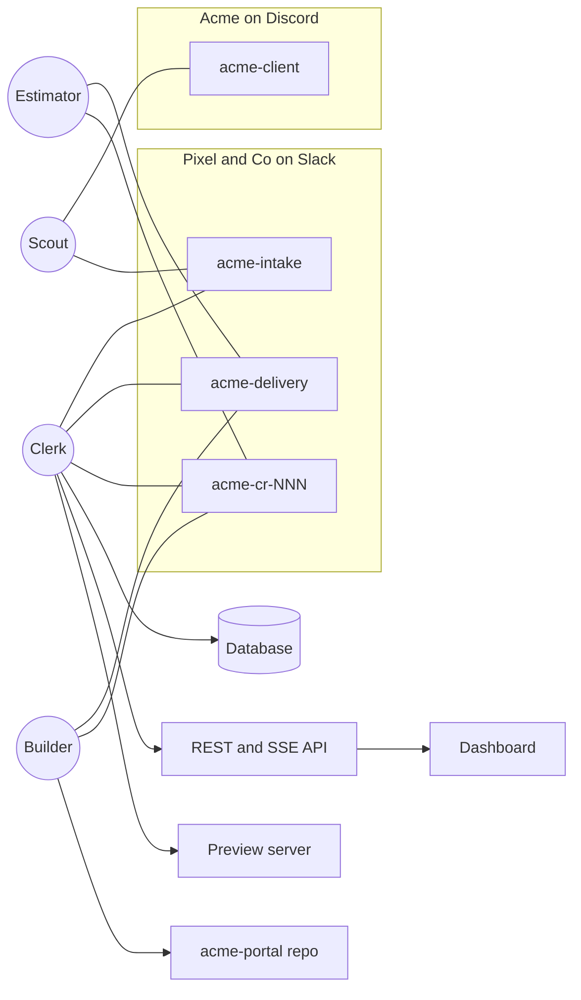

Skip section 11 (Dashboard) and phase 6. A separate session will build the
dashboard in the dashboard/ folder of this repo, so leave that folder empty.
Your API must match the data contract below exactly, including /api/rooms,
/api/public/co/:id, PATCH /api/change-requests/:id/options/:key and the stream
events room.message, question.answered and plan.updated.
Allow CORS from http://localhost:5173.

### Frontend Data Contract (from Frontend Prompt Section 9)

```typescript
export type Category =
  | 'DEFECT'
  | 'IN_SCOPE'
  | 'UNCLEAR'
  | 'OUT_OF_SCOPE'
  | 'DUPLICATE'
  | 'ALREADY_DECIDED';
export type AskStatus =
  | 'received'
  | 'classified'
  | 'question_pending'
  | 'ticketed'
  | 'change_open'
  | 'linked'
  | 'reminded'
  | 'change_sent'
  | 'approved'
  | 'swapped'
  | 'declined'
  | 'building'
  | 'preview'
  | 'accepted'
  | 'invoiced';
export type Confidence = 'high' | 'medium' | 'low';
export type OptionKey = 'A' | 'B' | 'C' | 'D';
export type ChatApp = 'discord' | 'slack' | 'mattermost' | 'teams';
export interface ChatLink {
  app: ChatApp;
  room: string;
  url: string;
}
export interface Ask {
  id: string;
  quote: string;
  requester: string;
  createdAt: string;
  status: AskStatus;
  category?: Category;
  clauseIds: string[];
  relatedItem?: string;
  decisionId?: string;
  confidence?: number;
  reason?: string;
  crId?: string;
  questionId?: string;
  workItemIds: string[];
  source: ChatLink;
}
export interface Question {
  id: string;
  askId: string;
  text: string;
  choices: string[];
  answer?: string;
  askedAt: string;
  answeredAt?: string;
}
export interface EstimateVersion {
  title?: string;
  p50Hours: number;
  p90Hours: number;
  confidence: Confidence;
}
export interface Estimate {
  full: EstimateVersion;
  smaller?: EstimateVersion;
  touches: string[];
  similar: { ref: string; hours: number }[];
  risks: string[];
  assumptions: string[];
  postedAt: string;
}
export interface OptionQuote {
  key: OptionKey;
  label: string;
  description: string;
  hours: number;
  priceCents: number;
  milestoneId?: string;
  shiftDays: number;
  newDue?: string;
  swapOut?: string[];
  swapIn?: string;
  draft?: boolean;
}
export interface EnvelopeResult {
  passed: boolean;
  failedRules: string[];
}
export interface ChangeRequest {
  id: string;
  askId: string;
  title: string;
  room: ChatLink;
  createdAt: string;
  status:
    | 'estimating'
    | 'awaiting_confirmation'
    | 'awaiting_approval'
    | 'sent'
    | 'decided'
    | 'closed';
  estimate?: Estimate;
  confirmedHours?: number;
  confirmedBy?: string;
  options: OptionQuote[];
  envelope?: EnvelopeResult;
  approvedBy?: string;
  approvedAt?: string;
  approvedOptions?: OptionKey[];
  clientChoice?: OptionKey | 'DECLINE';
  decidedAt?: string;
}
export interface WorkItem {
  id: string;
  askId: string;
  crId?: string;
  title: string;
  branch: string;
  prUrl?: string;
  previewUrl?: string;
  status: 'queued' | 'building' | 'pr_open' | 'preview' | 'merged' | 'accepted';
}
export interface DeskState {
  holder: 'priya' | 'scout';
  mode: 'copilot' | 'autopilot';
  since: string;
  nextHandoverAt: string;
  nextHolder: 'priya' | 'scout';
}
export interface Overview {
  month: string;
  revenueProtectedCents: number;
  changeOrders: {
    sent: number;
    approved: number;
    pending: number;
    swaps: number;
  };
  goodwill: { usedHours: number; bucketHours: number };
  medianAskToDecisionMinutes: number;
  asksByCategory: Record<Category, number>;
}
export interface LedgerEntry {
  date: string;
  ref: string;
  title: string;
  hours: number;
  amountCents: number;
  approvedBy?: string;
  link?: ChatLink;
  kind: 'change_order' | 'swap' | 'goodwill' | 'defect' | 'in_scope';
}
export interface PlanItem {
  id: string;
  title: string;
  deliverable: string;
  hours: number;
  status: 'done' | 'in_progress' | 'unstarted';
  doneOn?: string;
  priority?: number;
}
export interface Milestone {
  id: string;
  name: string;
  due: string;
  items: PlanItem[];
}
export interface Plan {
  capacityHoursPerWeek: number;
  milestones: Milestone[];
}
export interface Member {
  id: string;
  name: string;
  kind: 'person' | 'agent';
  side: 'client' | 'agency';
  vendor?: 'OpenCode' | 'Claude Code' | 'Codex' | 'Custom';
}
export interface Room {
  id: string;
  name: string;
  app: ChatApp;
  kind: 'client' | 'intake' | 'delivery' | 'change';
  members: Member[];
  roles: { name: string; holder?: string }[];
  references: string[];
}
export interface RoomMap {
  rooms: Room[];
  links: { from: string; to: string; description: string }[];
}
export interface StreamEvent {
  id: string;
  ts: string;
  type: string;
  actor: string;
  text: string;
  askId?: string;
  crId?: string;
  roomId?: string;
  link?: ChatLink;
  data?: unknown;
}
```

_Note on Python Serialization:_ Configure Clerk's Pydantic schemas with `model_config = ConfigDict(alias_generator=to_camel, populate_by_name=True)` so that Python `snake_case` attributes serialize to the exact `camelCase` keys shown above.

# ScopeKeeper — Build Prompt

## 1. Your role and working rules

You are a senior full-stack engineer and tech lead. Build **ScopeKeeper** for the Flip the Switch hackathon, Track 1 (Best Business Workflow): a workflow in team chat where people and AI agents get real work done together, connected through Switch, the open-source framework at [github.com/sandbox-quantum/switch](https://github.com/sandbox-quantum/switch).

How you work:

- **Plan first.** Before coding, write `docs/plan.md` with the architecture, the file tree and the phase checklist from section 16. Then build phase by phase. After each phase, run every test, fix failures, and write a short summary of what changed and what a person must check by hand.
- **Never invent Switch behaviour.** Before writing Switch code, read the official docs. Connect the docs MCP server at `https://docs.switchagents.ai/mcp` if your environment supports MCP; otherwise read [docs.switchagents.ai](https://docs.switchagents.ai/) (getting started, building, agent protocol, agent connection, templates, messaging apps) and the reference implementation in `core/switch_core/bridges/agent/`. Record every verified endpoint, operation, argument and event shape in `docs/switch-protocol-notes.md` with its source. Put anything unverified behind the adapter, mark it `TODO(verify)`, and log a clear warning when it runs.
- **Ports and adapters.** Switch, the LLM, the git host, previews and the clock sit behind interfaces with real and fake implementations. The whole workflow must run end to end on fakes, with no network, for tests and offline demos.
- **Deterministic money and dates.** Prices, hours and dates come from code (Python `Decimal`, `zoneinfo`), never from an LLM. Any LLM-written client text must pass the numbers check in section 9.
- **Chat is the source of truth.** Every decision is made or mirrored in a Switch room, and the ledger stores the link to that message. Dashboard actions post the same message to the right room.
- **Quality.** Typed Python (`mypy` strict on `domain/`), strict TypeScript, small modules, docstrings on public functions, no dead code, and no secrets in code or logs.
- **Explainable.** Add short comments on non-obvious logic and one paragraph per key decision in `docs/decisions.md`. The team must be able to explain every part to the judges.
- **The docs win conflicts.** If this prompt conflicts with the Switch docs, follow the docs, note it in `docs/decisions.md`, and change the design as little as possible.

---

## 2. What you are building

ScopeKeeper is a client desk run by people and AI agents from two companies on two chat apps. It turns every client ask into shipped work: it checks the ask against the signed scope of work, estimates it from the real code and git history, prices it in code, gets the right person's approval, has an agent build it, and gets the client's acceptance, all in chat. When the agency's day ends, the `@client-desk` room role is assumed by an agent (`Scout`) and released back to human coverage (`Priya`) in the morning, so the client's working day is never wasted.

The demo story is the acceptance test. Pixel & Co, an agency in Mumbai on Slack, builds the Acme Web Portal for Acme, a client in New York on Discord. The simulated date is Thursday, November 5, 2026.

1. At 7:00 PM IST, Clerk triggers the evening Flip: Priya goes off shift and Scout assumes `@client-desk` in `acme-client` (`MODE autopilot`).
2. At 10:00 AM ET (8:30 PM IST), Sam writes: _"Love the progress! Can you add dark mode, export reports to Excel, and we need an Android app for the board meeting on the 20th. Also the login button is broken on Safari."_
3. Within a minute Scout lists four asks. `ASK-0007`, the Safari login, is a defect (clause 1.1) and is fixed free. `ASK-0008`, dark mode, is in scope (clause 2.4). `ASK-0009`, Excel export, is unclear because clause 3.2 says CSV, so Scout asks one question. `ASK-0010`, the Android app, is out of scope (clause 1.3), so change room `CR-004` opens.
4. Sam answers _"a native .xlsx file"_. Clerk reclassifies it as out of scope; the Estimator sizes it at 3 h with high confidence; Clerk prices it at $140, inside the envelope, and sends `CR-005` to Sam at once. Sam approves and the Builder opens a pull request.
5. The Builder ships the Safari fix and dark mode on branches, previews go up, and Sam accepts dark mode.
6. In `CR-004` the Estimator posts P50 190 h and P90 240 h (medium) for the full app, and 56 h (high) for a view-only board-meeting version.
7. At 9:30 AM IST on November 6, Clerk posts the morning brief, Scout releases `@client-desk` (`MODE copilot`), and the desk returns to Priya. Ravi confirms 200 h. Clerk prices the options: A $10,350, moving milestone M2 from Dec 12 to Dec 24; B $10,350 in the next phase; C $2,650, moving M2 by 3 days; D the board-meeting version in place of unstarted item I9 (58 h) for $0. Priya approves.
8. Sam picks D. Clerk records the swap and updates the plan. The ledger shows two approved change orders this month worth $2,030 (seeded `CR-003` at $1,890 plus `CR-005` at $140) and one swap.

| Who           | Side                      | Kind                                                    | Holds                                                         | Job                                                                          |
| :------------ | :------------------------ | :------------------------------------------------------ | :------------------------------------------------------------ | :--------------------------------------------------------------------------- |
| **Sam**       | Acme, New York, Discord   | Person                                                  | none                                                          | Asks, answers, chooses options, accepts work                                 |
| **Priya**     | Pixel & Co, Mumbai, Slack | Person                                                  | Account Manager (`account-manager`); human client desk by day | Prices, goodwill, approvals outside the envelope                             |
| **Ravi**      | Pixel & Co                | Person                                                  | Delivery Lead (`delivery-lead`)                               | Confirms estimates and dates                                                 |
| **Aisha**     | Pixel & Co                | Person                                                  | none                                                          | Reviews and merges pull requests                                             |
| **Scout**     | Pixel & Co                | Agent: OpenCode via Switch Console                      | `@client-desk` (Switch room role) by night                    | Talks with the client; relays asks and decisions to Clerk                    |
| **Clerk**     | Pixel & Co                | Agent: your custom service on the Switch Agent Protocol | none                                                          | Scope, ledger, classification, prices, swaps, change rooms, the Flip, briefs |
| **Estimator** | Pixel & Co                | Agent: Claude Code via Switch Console, read-only        | none                                                          | Estimates from code and git history                                          |
| **Builder**   | Pixel & Co                | Agent: Codex via Switch Console, branch-only            | none                                                          | Builds approved work on branches and opens pull requests                     |

Not in scope for this build: payments, e-signatures, replacing the chat apps, autonomous pricing outside the envelope, and legal advice.

---

## 3. System architecture

Seven parts make up the system. You write three of them (Clerk, the dashboard and the demo app) and configure the rest.

1. **Switch server**, run locally by Switch Console (with or without Docker), bridging Slack for the agency and Discord for the client. Fallback: the bundled Mattermost with two teams.
2. **Console-run agents**: Scout (OpenCode), the Estimator (Claude Code) and the Builder (Codex), running on Switch Console's local managed machine controller. You write their instructions and setup steps, not their code.
3. **Clerk**, a Python FastAPI service with background workers. It connects to Switch as a custom agent over the Switch Agent Protocol (WebSocket stream + HTTP operations) and owns the domain logic, the ledger and the schedules.
4. **Database**: SQLite by default, Postgres through `docker-compose`.
5. **Dashboard**: a React single-page app on Clerk's REST API and live event stream.
6. **Demo app repo (`acme-portal`)** with seeded git history, plus a local preview server.
7. **GitHub** for issues and pull requests, optional; a local fallback keeps the demo working offline.



**Room group:** All rooms belong to the Switch room group `"Acme Web Portal"` (`create_room_group`) so the Switch Gateway UI renders the live room topology.

**Room membership.** Clerk must never be a member of `acme-client`.

| Member        | `acme-client` | `acme-intake` | `acme-delivery` | `acme-cr-NNN` |
| :------------ | :-----------: | :-----------: | :-------------: | :-----------: |
| **Sam**       |       ✓       |               |                 |               |
| **Priya**     |       ✓       |       ✓       |        ✓        |       ✓       |
| **Ravi**      |               |               |        ✓        |       ✓       |
| **Aisha**     |               |               |        ✓        |               |
| **Scout**     |       ✓       |       ✓       |                 |               |
| **Clerk**     |               |       ✓       |        ✓        |       ✓       |
| **Estimator** |               |               |        ✓        |       ✓       |
| **Builder**   |               |               |        ✓        |       ✓       |

**Room links**, each with a label (`link_rooms` is directional, so link both ways): `acme-client` ↔ `acme-intake` (_"asks in, client-ready answers out"_), `acme-intake` ↔ `acme-delivery` (_"approved work becomes tickets"_), `acme-delivery` ↔ each change room (_"one change request"_). Links grant no access; membership does.

**References and room documents:** Attach external references (`create_reference` + `attach_reference_to_room`) and room-scoped documents (`create_room_document` / `update_room_document`) as follows: `SOW.md` and `scope-map.yaml` on all four rooms; `rate-card.yaml`, `envelope.yaml`, `plan.yaml` and the repo only on `acme-delivery` and the change rooms. Because room documents cannot be opened directly inside bridged Slack/Discord clients, Clerk also posts human-readable summaries as messages while Console agents read the room documents directly via `load_internal_documents`.

**Roles and responsibilities:** In Switch 0.31, Switch room roles (`define_role`, `assume_role`, `release_role`) can only be assumed by agents. Human governance responsibilities (`account-manager`, `delivery-lead`, `on-call`) are mapped in `config/rooms.yaml` and verified by Clerk against the sender's Switch participant identity, and also documented as room roles/instructions for visibility.

| Role / Responsibility | Kind                                    | Rooms                         | Holder                                                                                                                                                                                          |
| :-------------------- | :-------------------------------------- | :---------------------------- | :---------------------------------------------------------------------------------------------------------------------------------------------------------------------------------------------- |
| `@client-desk`        | Switch Room Role (`exclusive: true`)    | `acme-client`                 | Unheld by an agent from 9:30 AM to 7:00 PM IST (Priya covers the human desk while Scout is in `copilot` mode); held by **Scout** (`assume_role`) from 7:00 PM to 9:30 AM IST (`autopilot` mode) |
| `@account-manager`    | Human governance role (+ room role doc) | `acme-delivery`, change rooms | **Priya** (verified by Clerk via `config/rooms.yaml`)                                                                                                                                           |
| `@delivery-lead`      | Human governance role (+ room role doc) | `acme-delivery`, change rooms | **Ravi** (verified by Clerk via `config/rooms.yaml`)                                                                                                                                            |
| `@on-call`            | Human governance role (optional)        | `acme-delivery`               | Whoever is on call, optional                                                                                                                                                                    |

**Ports and adapters inside Clerk:**

| Port          | Real adapter                                                                                                                                                                    | Fake adapter                                                                                |
| :------------ | :------------------------------------------------------------------------------------------------------------------------------------------------------------------------------ | :------------------------------------------------------------------------------------------ |
| `SwitchPort`  | `SwitchProtocolAdapter`: WebSocket event stream in (`GET /agents/{agent_id}/connection/ws`, with SSE fallback), HTTP operations out (`POST /agents/{agent_id}/ops/{operation}`) | `InMemorySwitch`: rooms, members, addressing, roles, placements, documents and an event bus |
| `LLMPort`     | Gemini (`google-genai` SDK), with optional Anthropic or OpenAI chosen by `LLM_PROVIDER`                                                                                         | `ScriptedLLM` returning fixtures                                                            |
| `GitHostPort` | `GitHubAdapter` over the REST API                                                                                                                                               | `LocalGitHost`: the `git` CLI plus a `tickets/` folder                                      |
| `PreviewPort` | `LocalPreviewServer`                                                                                                                                                            | `FakePreview`                                                                               |
| `ClockPort`   | `SystemClock` with an optional offset                                                                                                                                           | `SimulatedClock`                                                                            |

---

## 4. Tech stack and repository layout

Use current stable versions and pin them in lockfiles.

| Layer             | Choice                                                                                                                                                                                                          |
| :---------------- | :-------------------------------------------------------------------------------------------------------------------------------------------------------------------------------------------------------------- |
| **Clerk backend** | Python 3.12, FastAPI, Uvicorn, Pydantic v2 and `pydantic-settings`, SQLAlchemy 2 with Alembic, `httpx`, `websockets` (and `httpx-sse` fallback), APScheduler, `tenacity`, `structlog`, `ruamel.yaml`, GitPython |
| **LLM**           | An `LLMPort` with adapters for Gemini (`google-genai` SDK), Anthropic and OpenAI, plus `ScriptedLLM`                                                                                                            |
| **Database**      | SQLite by default; Postgres 16 in `docker-compose`                                                                                                                                                              |
| **Dashboard**     | Vite, React, TypeScript, Tailwind CSS, shadcn/ui, TanStack Query, React Router, Recharts, `EventSource`                                                                                                         |
| **Demo app**      | Self-contained Vite, React, TypeScript and Tailwind app with an in-memory API/data store; Vitest                                                                                                                |
| **Tests**         | `pytest`, `pytest-asyncio`, `time-machine`, `respx`; Vitest, Testing Library, Playwright                                                                                                                        |
| **Tooling**       | `uv`, `ruff`, `mypy`, `pre-commit`, ESLint, Prettier, `just`, Docker Compose, GitHub Actions                                                                                                                    |

Repository layout:

```text
scopekeeper/
├── README.md
├── BUILD_PROMPT.md
├── .env.example
├── docker-compose.yml
├── justfile
├── .github/workflows/ci.yml
├── config/
│   ├── sow/SOW.md
│   ├── scope-map.yaml
│   ├── rate-card.yaml
│   ├── plan.yaml
│   ├── envelope.yaml
│   ├── schedule.yaml
│   ├── rooms.yaml
│   └── seed-ledger.yaml
├── switch/
│   ├── templates/scopekeeper.template.yaml
│   ├── rooms/acme-client.md, acme-intake.md, acme-delivery.md, acme-cr.md
│   ├── roles/client-desk.md, account-manager.md, delivery-lead.md
│   └── agents/scout.md, estimator.md, builder.md
├── clerk/
│   ├── pyproject.toml
│   ├── alembic/
│   ├── src/clerk/
│   │   ├── main.py              # FastAPI app factory; lifespan starts the workers
│   │   ├── settings.py          # reads .env
│   │   ├── domain/              # pure logic, no I/O: models, categories, pricing, dates,
│   │   │                        # swaps, envelope, goodwill, states, parsing, templates,
│   │   │                        # numbers_check
│   │   ├── services/            # workflow, classifier, change_requests, flip, brief,
│   │   │                        # memory, renewal, invoice, scout_builtin
│   │   ├── ports/               # Protocol interfaces
│   │   ├── adapters/            # switch_protocol, switch_inmemory, llm_gemini,
│   │   │                        # llm_anthropic, llm_openai, llm_scripted, github,
│   │   │                        # local_git, preview_local, clock
│   │   ├── api/                 # routes, sse, auth
│   │   ├── db/                  # tables, session, repositories
│   │   ├── workers/             # switch_consumer, scheduler, timeouts
│   │   └── cli.py               # seed, reset, flip-now, eval
│   └── tests/unit, tests/integration, tests/contract, tests/fixtures
├── dashboard/
│   ├── package.json
│   └── src/app, pages, components, lib, hooks
├── demo-app/
│   ├── seed/seed_history.py
│   └── acme-portal/             # generated by the seed script
├── scripts/
│   ├── preview_server.py
│   ├── reset_demo.py
│   └── eval_classifier.py
└── docs/
    ├── plan.md, architecture.md, switch-setup.md
    └── switch-protocol-notes.md, demo-script.md, decisions.md
```

---

## 5. Configuration files and database

Load every config file into a Pydantic model at startup and fail fast with a readable error if one is invalid. Ship these exact contents for the demo.

### `config/scope-map.yaml`

```yaml
project: Acme Web Portal
client: Acme Inc.
sow_version: '1.2'
warranty_days: 30
deliverables:
  - {
      id: D1,
      clause: '1.1',
      title: Responsive web app,
      includes:
        [
          desktop and mobile browsers,
          latest two versions of Chrome,
          Safari and Firefox,
          login,
        ],
    }
  - {
      id: D2,
      clause: '2.4',
      title: Theming,
      includes: [light theme, dark theme, brand colours, brand typeface],
    }
  - {
      id: D3,
      clause: '3.2',
      title: Reports page,
      includes: [filters, CSV export],
    }
  - { id: D4, clause: '4.1', title: Admin analytics dashboard }
exclusions:
  - { clause: '1.3', text: 'Native mobile apps (iOS, Android)' }
  - { clause: '3.5', text: Third-party BI integrations }
change_policy:
  goodwill_hours_per_month: 8
  goodwill_suggest_below_hours: 2
  swap: { allowed: true, tolerance: 0.10, only_unstarted: true }
```

### `config/rate-card.yaml`

```yaml
currency: USD
blended_rate: 45
contingency: { high: 0.05, medium: 0.15, low: 0.25 }
round_to: 10
```

### `config/plan.yaml`

```yaml
capacity_hours_per_week: 120
milestones:
  - id: M1
    name: Launch
    due: 2026-10-25
    items:
      - {
          id: I1,
          title: Responsive layout and login,
          deliverable: D1,
          hours: 46,
          status: done,
          done_on: 2026-10-20,
        }
      - {
          id: I2,
          title: Reports page with filters v1,
          deliverable: D3,
          hours: 40,
          status: done,
          done_on: 2026-10-25,
        }
  - id: M2
    name: Reporting release
    due: 2026-12-12
    items:
      - {
          id: I8,
          title: CSV export,
          deliverable: D3,
          hours: 12,
          status: done,
          done_on: 2026-10-28,
        }
      - {
          id: I9,
          title: Admin analytics dashboard,
          deliverable: D4,
          hours: 58,
          status: unstarted,
          priority: 3,
        }
      - {
          id: I10,
          title: Report filters v2,
          deliverable: D3,
          hours: 24,
          status: unstarted,
          priority: 2,
        }
```

### `config/envelope.yaml`

```yaml
max_price_usd: 500
min_confidence: high
milestone_impact_days: 0
client_in_good_standing: true
```

### `config/schedule.yaml`

```yaml
agency_timezone: Asia/Kolkata
client_timezone: America/New_York
flip:
  { to_agent_at: '19:00', to_person_at: '09:30', agent: scout, person: priya }
morning_brief_at: '09:30'
demo: { simulated_start: '2026-11-05T19:00:00+05:30' }
```

### `config/rooms.yaml`

Maps names, agent registry names, and human usernames/roles to Switch ids, filled in after setup:

```yaml
group:
  name: Acme Web Portal
  color: '#4F46E5'
rooms:
  client: { name: acme-client, id: '<fill after setup>' }
  intake: { name: acme-intake, id: '<fill after setup>' }
  delivery: { name: acme-delivery, id: '<fill after setup>' }
  change_room_prefix: acme-cr-
handles:
  scout: '@acme-scout'
  estimator: '@acme-estimator'
  builder: '@acme-builder'
  clerk: '@clerk'
people:
  sam: { display: Sam, username: sam, side: client, roles: [] }
  priya:
    {
      display: Priya,
      username: priya,
      side: agency,
      roles: [account-manager, client-desk],
    }
  ravi: { display: Ravi, username: ravi, side: agency, roles: [delivery-lead] }
  aisha: { display: Aisha, username: aisha, side: agency, roles: [] }
```

### `config/seed-ledger.yaml`

Holds the history before the demo: `ASK-0001` to `ASK-0006`; `DEC-002` on Oct 15, _"Notifications are email-only; no SMS"_; `CR-001` declined on Oct 22 (Slack integration); `CR-002` approved on Oct 30 (20 h, high, $950); `CR-003` approved on Nov 2 (Report scheduling, 40 h, high, $1,890); 2 h of goodwill on `ASK-0006` on Nov 3.

### `config/sow/SOW.md`

Write a realistic two-page statement of work with clauses 1.1, 1.3, 2.4, 3.2, 3.5 and 4.1 as above, a 30-day warranty clause (5.1), and a change clause (6.1) that prices changes at the rate card or swaps them for unstarted items of equal size.

### Database tables

SQLAlchemy models plus an Alembic migration. Store money as integer cents and IDs in the formats shown.

| Table              | Key columns                                                                                                                                                                                                                 |
| :----------------- | :-------------------------------------------------------------------------------------------------------------------------------------------------------------------------------------------------------------------------- |
| `asks`             | `id` (`ASK-0001`), `source_room`, `source_message_id`, `source_link`, `requester`, `quote`, `category`, `clause_ids`, `related_item`, `decision_id`, `confidence`, `status`, `cr_id`, `created_at`, `decided_at`, `version` |
| `questions`        | `id` (`Q-0001`), `ask_id`, `text`, `choices`, `answer_text`, `answer_link`, `asked_at`, `answered_at`                                                                                                                       |
| `change_requests`  | `id` (`CR-001`), `ask_id`, `room_id`, `status`, `estimate` (JSON), `confirmed_hours`, `confirmed_by`, `options` (JSON), `envelope_result` (JSON), `approved_by`, `approved_at`, `client_choice`, `decided_at`, `version`    |
| `decisions`        | `id` (`DEC-001`), `date`, `text`, `link`, `source` (`seed`, `client` or `agency`)                                                                                                                                           |
| `work_items`       | `id` (`W-0001`), `ask_id`, `cr_id`, `ticket_url`, `branch`, `pr_url`, `preview_url`, `status`                                                                                                                               |
| `goodwill`         | `id`, `ask_id`, `hours`, `reason`, `approved_by`, `month`                                                                                                                                                                   |
| `swaps`            | `id`, `cr_id`, `added_title`, `removed_item_ids`, `hours_added`, `hours_removed`                                                                                                                                            |
| `role_shifts`      | `id`, `role`, `from_holder`, `to_holder`, `at`, `verified`                                                                                                                                                                  |
| `events`           | `id`, `ts`, `type`, `actor`, `ask_id`, `cr_id`, `payload` (JSON), `message_link`                                                                                                                                            |
| `processed_events` | `switch_event_id`, `processed_at`                                                                                                                                                                                           |
| `settings`         | `key`, `value` (clock offset, flags)                                                                                                                                                                                        |

Every state change writes an `events` row in the same transaction.

---

## 6. Chat protocols and commands

Agents talk in fixed formats so Clerk can parse them. Parsers must tolerate case, extra words and code fences; when a message can't be parsed, Clerk replies with the expected format instead of guessing. Clerk assigns every ID.

### `acme-intake` formats (Scout and Clerk)

```text
# Scout -> Clerk
ASK | "<exact quote>" | requester=<name> | link=<url>       # one ask; Clerk replies "ASK-0007 received"
ANSWER Q-0001 | "<quote>" | link=<url>                      # the client's answer to a question
DECISION CR-004 D | link=<url>                              # the client's choice: A, B, C, D or DECLINE
ACCEPT ASK-0008 | link=<url>                                # the client accepted a preview
DISPUTE ASK-0009 | "<quote>" | link=<url>                   # client says it should be in scope; goes to @account-manager
DRAFT ASK-0007: <text>                                      # copilot mode: a reply for Priya to send or approve

# Clerk -> Scout
READY ASK-0007
<client-ready text>                                         # Scout posts the text in acme-client unchanged

QUESTION Q-0001 for ASK-0009
<text>
Choices: 1) ... 2) ...

MODE autopilot until 09:30 IST (11:00 PM ET)                # Scout calls assume_role(role="client-desk") in acme-client
# or:
MODE copilot                                                # Scout calls release_role() in acme-client
```

### Estimator request and reply (change rooms)

Clerk sends a targeted message (`send_targeted_message` with `target_names=["acme-estimator"]`):

```text
@acme-estimator estimate CR-004 for ASK-0010: "we need an Android app for the board meeting on the 20th". Context: clause 1.3 excludes native apps. Repo: acme-portal. Reply to @clerk with exactly one fenced block whose info string is scopekeeper-estimate.
```

The Estimator replies with JSON in that block:

```json
{
  "cr_id": "CR-004",
  "full": { "p50_hours": 190, "p90_hours": 240, "confidence": "medium" },
  "smaller": {
    "title": "Board-meeting version: view-only dashboards",
    "p50_hours": 56,
    "p90_hours": 64,
    "confidence": "high"
  },
  "touches": ["api/auth", "api/reports", "new mobile/ package"],
  "similar": [
    { "ref": "merge: Reports v2", "hours": 61 },
    { "ref": "merge: Admin users page", "hours": 52 },
    { "ref": "merge: Auth refresh", "hours": 18 }
  ],
  "risks": [
    "push notifications not in the current backend",
    "app-store review time"
  ],
  "assumptions": ["reuse the existing REST API"]
}
```

### People's commands

Case-insensitive, accepted only from the authorized human holder configured in `config/rooms.yaml` (verified against the Switch event's `sender_name` / `user_id` via `list_participants`):

| Who                        | Command                                                                                                                         | Effect                                    |
| :------------------------- | :------------------------------------------------------------------------------------------------------------------------------ | :---------------------------------------- |
| `@delivery-lead` (Ravi)    | `@clerk hours 200` or `@clerk confirm`                                                                                          | Sets confirmed hours; `confirm` takes P50 |
| `@delivery-lead` (Ravi)    | `@clerk hours smaller 56`                                                                                                       | Confirms the smaller version's hours      |
| `@account-manager` (Priya) | `@clerk approve` or `@clerk approve A,C,D`                                                                                      | Approves all or some options              |
| `@account-manager` (Priya) | `@clerk price A 9800`                                                                                                           | Overrides one option's price; logged      |
| `@account-manager` (Priya) | `@clerk goodwill ASK-0011`                                                                                                      | Marks a small ask free from the bucket    |
| `@account-manager` (Priya) | `@clerk decline CR-004 <reason>`                                                                                                | Declines; Scout tells the client politely |
| Anyone internal            | `@clerk ledger`, `@clerk invoice november`, `@clerk renewal`, `@clerk status CR-004`, `@clerk what did we agree about <topic>?` | Read-only answers                         |
| Anyone internal, demo mode | `@clerk flip now`, `@clerk morning now`, `@clerk clock +10h`                                                                    | Demo controls                             |

### Builder work orders (`acme-delivery`)

Clerk sends a targeted message (`send_targeted_message` with `target_names=["acme-builder"]`):

```text
@acme-builder WORK W-0003 for ASK-0008 (dark mode, clause 2.4)
Ticket: <issue url or tickets/ASK-0008.md>
Branch: sk/ask-0008-dark-mode
PR title: [ASK-0008] Dark mode
Done when: <acceptance criteria>
Reply: @clerk DONE W-0003 pr=<url>
```

Clerk also polls the git host for the branch and pull request, so a missing `DONE` message never blocks the flow.

### Client-facing templates

Scout posts `READY` text verbatim. Keep client messages to five lines, except change orders.

- **Acknowledgement:** `"Got it, Sam. I see four things here; back in a minute with each one."`
- **Verdicts:** a numbered list, one line per ask, with the clause in brackets.
- **Preview:** `"Dark mode is ready to try: <url>. Reply 'accept' if it looks right."`
- **Handover:** `"Hi Sam, I'm covering the desk until 11 PM your time. Priya is back after that."`
- **Change order:**

```text
The Android app is outside our current agreement (clause 1.3, web only). Your options:
A) Full app now: $10,350; the December 12 milestone moves to December 24
B) Full app in the next phase: $10,350; no change to current dates
C) Board-meeting version by November 20: $2,650; the milestone moves about 3 days
D) Board-meeting version instead of the admin analytics dashboard: no extra cost, no date change
Reply with A, B, C, D, or "not now".
```

**Internal templates:** the change-room opening message, the morning brief (came in, shipped, needs a yes, with the exact approve command per change request), the ledger, the invoice CSV (`date,change,option,hours,price_usd,approved_by,link`) and the renewal report.

---

## 7. Workflow logic

Clerk runs one state machine per ask and one per change request. Every transition is a function in `domain/states.py` with unit tests for allowed and forbidden moves.

**Ask states:** `received` → `classified` → one of `question_pending`, `ticketed`, `change_open`, `linked` (duplicate) or `reminded` (already decided). `question_pending` returns to `classified` on an answer. `change_open` → `change_sent` → `approved`, `swapped` or `declined`. `ticketed`, `approved` and `swapped` → `building` → `preview` → `accepted`; paid change orders end at `invoiced`.

**Classification, in this order:**

1. **Pre-checks in code.** A recorded decision the ask contradicts makes `ALREADY_DECIDED` a candidate. An open, planned or done item with a similar title (normalised token overlap of 0.6 or more) makes `DUPLICATE` a candidate; the LLM confirms.
2. **LLM classification** with the scope map, plan, decisions and the quoted ask (section 9). It returns `category`, `clause_ids`, `related_item`, `decision_id`, `confidence` and a `reason`.
3. **Post-rules in code.** `DEFECT` needs a related deliverable where at least one linked plan item (or the specific `related_item`) has `status == "done"` and `(current_date - done_on).days <= warranty_days`; otherwise reclassify and log why. Confidence below 0.7 becomes `UNCLEAR`. An exclusion always beats an inclusion.

**Actions by category:** `DEFECT` and `IN_SCOPE` create a ticket and a work order. `DUPLICATE` links the existing item. `ALREADY_DECIDED` quotes and links the decision and asks whether to change it; a yes creates a new ask. `UNCLEAR` asks one question with two or three choices. `OUT_OF_SCOPE` starts the change path.

**Change path:**

1. Create the change room `acme-cr-NNN` through Switch (`create_room` with `group_name="Acme Web Portal"`): set instructions, invite `Priya`, `Ravi`, the `Estimator` and the `Builder`, link it bidirectionally to `acme-delivery` (`link_rooms`), attach references (`attach_reference_to_room`), and create a live room document (`create_room_document`) with the ask details and SOW context. If room creation isn't available, take the next free room from a pre-created pool, `acme-cr-001` to `acme-cr-010`.
2. Ask the Estimator (`send_targeted_message` to `acme-estimator`). Remind at 10 minutes. At 30 minutes, fall back to a heuristic estimate from similar past merges, marked `low` confidence.
3. Get confirmed hours from `@delivery-lead`, unless the envelope allows P50 at `high` confidence.
4. Compute price, date impact, options and swaps, then check the envelope.
5. Inside the envelope, send `READY` to Scout. Outside it, ask `@account-manager` with the exact approve command; during autopilot hours, queue it for the morning brief.
6. Record the client's decision, then create work items, record a swap, or close as declined.
7. Close the room with a one-line summary and a link to the ledger entry, then archive it via `archive_room`.

**Price**, with `Decimal` and `ROUND_HALF_UP` to `round_to`:

$$\text{price} = \operatorname{round}_{10}\big(h \times r \times (1 + c)\big)$$

Unit-test these: 3 h high is $140; 200 h medium is $10,350; 56 h high is $2,650; 40 h high is $1,890; 20 h high is $950.

**Date impact:** add `round_half_up(hours / capacity_hours_per_week * 7)` calendar days to the affected milestone. Tests: 200 h is 12 days (Dec 12 to Dec 24); 56 h is 3 days.

**Options:**

- **A**: now, full price, shifts the milestone.
- **B**: next phase, full price, no shift now.
- **C**: the smaller version at its own price and shift; skip it if there is none.
- **D**: a swap; skip it if there is no candidate.

**Swap finder:** candidates are unstarted in-scope plan items. Check `confirmed_hours` first; if no candidate matches `confirmed_hours` and the estimate includes a `smaller` version, run the swap finder against `smaller.p50_hours` and title Option D with the smaller version (e.g., _"Board-meeting version instead of the admin analytics dashboard"_). Prefer a single item with a size gap no larger than `tolerance * target_hours`; otherwise the best pair. Choose the smallest gap, then the lowest priority (the highest number), then the lowest id. Test: 200 h has no match on its own, so Option D uses `smaller` (56 h), which matches `I9` at 58 h (a 3.6% gap: $|58 - 56| / 56 = 0.0357 \le 0.10$).

**Envelope:** every rule must pass (`price_usd <= max_price_usd`, `confidence >= min_confidence`, `milestone_impact_days <= envelope.milestone_impact_days`, `client_in_good_standing == True`); return the names of failing rules. Swaps always need `@account-manager`.

**Goodwill:** for asks under `goodwill_suggest_below_hours`, Clerk suggests goodwill while the month's bucket allows it; only `@account-manager` decides.

**Approvals:** before accepting a human command (`hours`, `confirm`, `approve`, `price`, `goodwill`, `decline`), Clerk checks that the sender matches the configured human holder in `config/rooms.yaml` (using participant metadata from `list_participants` and the event's `sender_name` / `user_id`). If the sender is not authorized, Clerk refuses politely in the room. If a required role has no configured holder, post a visible warning and queue the decision.

**The Flip:** in Switch 0.31, room roles (`define_role`, `assume_role`, `release_role`) are agent-only instruction bundles backed by a heartbeat lease (`POST /agents/{agent_id}/leases/renew` or the Console session lease).

- At `to_agent_at` (`19:00` IST): Clerk sends a targeted message in `acme-intake` to `@acme-scout`: `MODE autopilot until 09:30 IST (11:00 PM ET)`. Upon receiving `MODE autopilot`, Scout calls `assume_role(role="client-desk")` in `acme-client` and greets Sam in one line. Clerk verifies via `get_role_detail(room_id=acme_client_id, role_name="client-desk")` that `held_by` contains `acme-scout`. If `held_by` is still empty after 30 seconds, Clerk retries the targeted command once, warns in `acme-delivery`, and if `SCOUT_MODE=builtin` is enabled, has the builtin Scout assume the role directly.
- At `to_person_at` (`09:30` IST): Clerk sends `MODE copilot` to `@acme-scout` in `acme-intake`. Scout calls `release_role()` in `acme-client`. Clerk verifies via `get_role_detail` that `held_by` is empty (returning day desk coverage to Priya), posts the morning brief in `acme-delivery`, and writes a `role_shifts` row each time.

**Morning brief:** what came in overnight, what shipped (pull request and preview links), what needs a yes (each change request with its exact approve command), and goodwill left this month. Also update the `ledger-summary` room document in `acme-delivery`.

**Memory:** `@clerk what did we agree about <topic>?` searches decisions, asks and change requests, then answers in two to four lines with links. If there is no evidence, say so.

**Renewal report:** group out-of-scope asks by theme and propose add-ons with total hours computed in code.

**Concurrency and idempotency:** one database transaction per event, optimistic locking with the `version` column, and events already in `processed_events` are skipped.

---

## 8. Switch integration

Verify first, then build the adapter, then configure the rooms and agents.

Verify and record in `docs/switch-protocol-notes.md` (against `docs.switchagents.ai` and `core/switch_core/bridges/agent/`):

1. **Registration & Auth:** `POST /agents` with a `registration` API key (`Authorization: Bearer <registration_key>`) and body `{name, description, display_name, connector_type, integration_profile, tools, models, overwrite}` returns `{id, api_key}` once. All subsequent calls use `Authorization: Bearer <agent_api_key>`.
2. **Primary Event Stream & Heartbeat (Switch 0.31):**
   - Primary transport is **WebSocket**: `GET /agents/{agent_id}/connection/ws?connection_id=<uuid>&scope=all&filter=all&rooms=<csv>&start_from=<cursor>&expected_generation=<gen>`.
   - Server sends `connection_state` (with `generation`, `rooms`, `cursor`, `position`), `ping` (every **2 seconds**), `gap`, `subscription_changed`, `evicted`, `room_released`, and room events (`message`, `command`).
   - Client **must** run an independent async ping/pong task that replies `{"type": "pong", "cursor": <seq>}` immediately on every `ping` so slow LLM calls never breach the **6-second** `heartbeat_lapsed` TTL.
   - If the server closes or sends `evicted` with `code: "taken_over"`, stop and do not reconnect.
   - SSE (`GET /agents/{agent_id}/events` + `POST /agents/{agent_id}/connection/beat`) is deprecated in Switch 0.31; keep it only as an optional fallback.
3. **Room Session Placement & Operations (`POST /agents/{agent_id}/ops/{operation}`):**
   - Switch validates operation arguments strictly by Python signature inspection (`HTTP 400` on unknown keys).
   - Several room-scoped operations (`post_message`, `send_targeted_message`, `list_roles`, `define_role`, `assume_role`, `release_role`, `create_room_document`, `update_room_document`, `load_internal_documents`) resolve their target room from the caller's **session placement**, not a `room_id` field in the JSON body.
   - Before calling a room-bound operation for room $R$, bind a session placement via `POST /agents/{agent_id}/connection/placements` with `{"connection_id": conn_id, "placements": [{"session_id": f"sess-{R}", "room_id": R}]}` (or call `connect_to_room` with `{"room_id": R}`) and send headers `X-Switch-Connection-Id: <conn_id>` and `X-Switch-Session-Id: sess-<R>`.
   - Exact verified operation signatures:
     - `post_message`: `{"body": text, "thread_id": thread}` (room from session placement) or `POST /agents/{agent_id}/message` with `{"room_id": room, "content": text}`.
     - `send_targeted_message`: `{"body": text, "target_names": [...], "target_roles": [...], "thread_id": thread}` (room from session placement; pass bare agent names like `"acme-estimator"` without `@`, or `"everyone"`).
     - `read_context`: `{"limit": 50, "since": since, "before": before, "room_id": room}`.
     - `create_room`: `{"name": ..., "description": ..., "agent_names": [...], "user_names": [...], "channel_type": ..., "bridge_id": ..., "instructions": ..., "reference_ids": [...], "linked_rooms": [{"target_room_id": ..., "label": ...}], "group_name": "Acme Web Portal", "roles": [{"name": ..., "instructions": ..., "exclusive": ...}]}`.
     - `invite_agent_to_room`: `{"room_id": room, "agent_name": agent_name}` and `add_users_to_room`: `{"room_id": room, "user_names": [username]}`.
     - `link_rooms`: `{"source_room_id": a, "target_room_id": b, "label": description}`.
     - `create_reference` + `attach_reference_to_room`: `{"room_id": room, "reference_id": ref_id}`.
     - `create_room_document` / `update_room_document`: `{"name": ..., "description": ..., "instructions": ..., "content": ...}` (room from session placement).
     - `get_role_detail`: `{"room_id": room, "role_name": role}` (returns `{"name", "exclusive", "instructions", "held_by": [...]}`).
     - `assume_role`: `{"role": role}` and `release_role`: `{}` (room from session placement; while holding a role from a custom process, renew its lease via `POST /agents/{agent_id}/leases/renew` with `X-Switch-Connection-Id`).
     - `archive_room`: `{"room_id": room}`.
4. **Live Runtime State (`POST /agents/{agent_id}/runtime-state`):**
   - Clerk reports `{"room_id": room, "state": "working" | "awaiting-input" | "idle", "thread_id": thread, "detail": detail}` while classifying asks, computing options, or waiting on human confirmation so Slack/Discord and the Switch UI show native live status indicators.

### `SwitchPort`

```python
class SwitchPort(Protocol):
    async def connect(self) -> None: ...
    def events(self) -> AsyncIterator[SwitchEvent]: ...
    async def post(self, room: RoomRef, text: str, thread: str | None = None) -> MessageRef: ...
    async def send_targeted(
        self,
        room: RoomRef,
        targets: list[str],
        text: str,
        target_roles: list[str] | None = None,
        thread: str | None = None,
    ) -> MessageRef: ...
    async def read_context(self, room: RoomRef, since: str | None = None) -> list[SwitchMessage]: ...
    async def create_room(self, spec: RoomSpec) -> RoomRef: ...
    async def archive_room(self, room: RoomRef) -> None: ...
    async def invite(self, room: RoomRef, member: str, is_human: bool = False) -> None: ...
    async def link(self, a: RoomRef, b: RoomRef, description: str) -> None: ...
    async def attach_reference(self, room: RoomRef, ref: Reference) -> None: ...
    async def upsert_document(self, room: RoomRef, doc: RoomDocumentSpec) -> None: ...
    async def role_holder(self, room: RoomRef, role: str) -> str | None: ...
    async def assume_role(self, room: RoomRef, role: str) -> None: ...
    async def release_role(self, room: RoomRef, role: str) -> None: ...
    async def set_runtime_state(
        self, room: RoomRef, state: Literal["working", "awaiting-input", "idle"], detail: str | None = None
    ) -> None: ...
```

**Adapter behaviour:** reconnect with exponential backoff and jitter; resume from the last cursor (`start_from` and `expected_generation`); on a `gap` frame, re-read context (`read_context`) before acting; reply to WebSocket `ping` frames within 2 seconds on a dedicated background task; renew role leases when holding a role; record each event id in `processed_events`; **refuse in code (`PermissionError`) any post or session placement by Clerk to `acme-client`**; post at most one message per room every 3 seconds and never post acknowledgement-only text.

`InMemorySwitch` mirrors the same rules (rooms, members, addressing policies, roles including the no-holder case, placements, links, references, room documents, runtime states) so the integration tests replay the demo without a server.

### Setup steps for `docs/switch-setup.md`

1. Install Switch Console (0.40+), start a local server, and connect Slack and Discord. Fallback: Mattermost with two teams.
2. Create the `"Acme Web Portal"` room group, then create `acme-client` on Discord and `acme-intake` and `acme-delivery` on Slack; set each room's instructions from `switch/rooms/`.
3. Add **Scout** (OpenCode), the **Estimator** (Claude Code, working directory `acme-portal`, read-only permissions) and the **Builder** (Codex, working directory `acme-portal`, branch-only).
   - Set **addressing** (`update_agent_detail`) to `anyone` (`Anyone`) for **Scout** and **Clerk** so external client users (Sam) and any room participant can reach them.
   - Keep **Estimator** and **Builder** at `owner_and_owner_agents` (`owner-agents` in templates) so only the agency owner and Clerk can instruct them.
   - Set their instructions from `switch/agents/`.
4. In `acme-client`, configure **Scout** as the room's assigned main agent (`!assign-agent @acme-scout` and `!follow-ups on`) during autopilot shifts so unaddressed messages from Sam in Discord are automatically routed to Scout without Sam needing to type `@acme-scout`.
5. Register **Clerk** as a custom agent (`POST /agents`), put its credentials in `.env`, and add it to `acme-intake` and `acme-delivery` only.
6. Define the roles from `switch/roles/` (`define_role` for `client-desk` with `exclusive: true` in `acme-client`, and role definitions in `acme-delivery` and change rooms) and verify human usernames in `config/rooms.yaml`.
7. Attach references and room documents as in section 3, and link the rooms bidirectionally with their descriptions.
8. Capture the finished rooms and agents into `switch/templates/scopekeeper.template.yaml` following `docs/TEMPLATES.md` (`version: 1` / `version: 2` Group Template with `params:`, `agents:` with `provider`, `location`, `directory`, `addressing`, `group:`, `rooms:` with `roles:`, `references:`, `docs:`, `kickoff:`, and `links:`), then validate keys with `get_template_guide` / `save_template(bypass_warnings=False)`.

### Instruction files

Write these files with these texts:

```markdown
=== switch/rooms/acme-client.md ===
This room is shared with Acme, our client. People here may not be technical.

- Reply in plain English, at most 5 short lines. No code, tool names or internal names.
- Never state a price, date or scope decision unless Clerk sent it to you in acme-intake.
- Never say no. Offer the options Clerk gives you and ask for one choice.
- Ask one question at a time, with 2 or 3 choices when you can.
- When a message holds several asks, list them back numbered before answering.
- If you hold @client-desk, answer every client message within a minute. If not, draft your reply in acme-intake for Priya.
- Defects are always free. Say so.

=== switch/rooms/acme-intake.md ===
Handoff room between Scout (client desk) and Clerk (contract keeper).

- Use only the formats in BUILD_PROMPT section 6.
- No rates, margins or internal opinions in this room.
- Scout copies READY text to acme-client without changing any fact or number.

=== switch/rooms/acme-delivery.md ===
Internal delivery room for Acme.

- The Builder posts a link for every issue, pull request and preview it creates.
- The Estimator posts estimates only in change rooms.
- Agents post nothing that only acknowledges ("ok", "thanks", "on it").
- While a decision is with a person, agents wait silently.
- Clerk posts the morning brief at 9:30 AM IST and the ledger on request.

=== switch/rooms/acme-cr.md ===
This room holds one change request. Steps run in this order; each agent speaks only on its step.

1. The Estimator posts the estimate.
2. @delivery-lead confirms or adjusts the hours.
3. Clerk posts the price, the date impact and the options.
4. @account-manager approves, edits or declines (skipped when the envelope allows).
5. Clerk sends the client-ready change order to acme-intake and closes this room when the client decides.

=== switch/roles/client-desk.md ===
You are covering the client desk while the agency team is offline.

- At the start of your shift, tell the client once that you are covering until 11 PM their time.
- Handle every ask through Clerk. Send a change order only when Clerk marks it in-envelope.
- Emergency, such as the site being down: page @on-call at once.
- Anything else that needs a person: tell the client Priya will reply by 11 PM their time, and flag it in acme-delivery.

=== switch/agents/scout.md ===
You are Scout, the client desk for Acme. Follow each room's instructions. Relay every client ask, answer, choice, acceptance or dispute to acme-intake in the exact formats. Call assume_role(role="client-desk") when Clerk sends MODE autopilot, and call release_role() when Clerk sends MODE copilot. Every price, date or scope ruling you state comes from Clerk.

=== switch/agents/estimator.md ===
You are the Estimator for acme-portal. Never edit files. When Clerk asks in a change room, map the ask to code, size it, find the three most similar past merges using their Effort-Hours trailers, and reply to @clerk with one fenced block tagged scopekeeper-estimate in the schema you were given. Offer a smaller version when the full ask is large.

=== switch/agents/builder.md ===
You are the Builder for acme-portal. Build only work orders Clerk sends as WORK. Use the given branch and pull-request title, never push to main, run the tests, open the pull request, then reply "@clerk DONE <work id> pr=<url>".
```

Role instructions for `switch/roles/account-manager.md` and `switch/roles/delivery-lead.md` document the human's commands from section 6.

**Known gotchas to handle in code and docs:**

- Switch tasks were removed in version 0.31.0, so use GitHub Issues or local tickets (`tickets/ASK-NNNN.md`).
- New agents default to `owner_and_owner_agents` addressing; set Scout and Clerk to `anyone` while keeping Estimator and Builder at `owner_and_owner_agents`.
- Only agents can hold Switch room roles (`assume_role` / `release_role`), and a role with no holder swallows `@role` messages—so verify role holders via `get_role_detail` and verify human commands against `config/rooms.yaml`.
- Room-scoped operations require an active session placement (`POST /agents/{agent_id}/connection/placements` + `X-Switch-Connection-Id` and `X-Switch-Session-Id`).
- WebSocket connections drop after 6 seconds without a `pong`; run `ping`/`pong` on an independent task.
- Edited room/agent instructions reach Console agents only after they reconnect.
- Per-agent and per-workspace spend caps (`HTTP 429 BudgetExceeded`) block posts once reached.
- Room documents can't be opened from bridged Slack/Discord chats, so post human summaries as messages in addition to updating room documents.

**Scout fallback:** if a Console agent isn't running or `SCOUT_MODE=builtin` is set, Clerk's process runs a second custom agent identity, Scout, which joins `acme-client` and `acme-intake` only, assumes/releases `@client-desk`, splits messages with the LLM and relays them in the same formats. Keep it in `services/scout_builtin.py`, and never let it import the database or pricing modules.

---

## 9. LLM prompts and guards

Use the LLM only to read messages and write words: temperature 0, JSON validated against a Pydantic schema, one repair retry, then a safe fallback. Cache results by message hash and use a fast model for classification.

```python
class LLMPort(Protocol):
    async def json(self, system: str, user: str, schema: type[BaseModel]) -> BaseModel: ...
    async def text(self, system: str, user: str, max_words: int) -> str: ...
```

**Classifier system prompt:**

```text
You classify one client request against a signed scope of work for a software agency. Return JSON only, matching the schema.
Categories:
- DEFECT: something the contract promised does not work as specified.
- IN_SCOPE: matches a deliverable or inclusion in the scope map.
- DUPLICATE: already delivered, planned or in progress; give the item id.
- UNCLEAR: a clause partly matches and the request could be read either way.
- OUT_OF_SCOPE: matches an exclusion, or no deliverable covers it.
- ALREADY_DECIDED: contradicts a recorded decision; give the decision id.
Rules: an exclusion beats an inclusion. Cite clause ids exactly as given. Never invent clauses, items or decisions. If unsure, choose UNCLEAR and write one question with 2 or 3 short choices.
```

The user message carries the scope map, plan items with status and dates, decisions, and the quoted ask. Output schema: `category`, `clause_ids`, `related_item`, `decision_id`, `confidence` (0 to 1), `reason` (25 words at most), and optional `question` and `choices`.

**Client wording:** pass a `facts` JSON (names, clause, options with prices and dates) and require plain English, five lines at most except change orders, no jargon and no promises beyond the facts.

**Numbers check:** extract every number, money amount and date from generated text. Each must appear in the `facts` JSON; otherwise retry once, then use the fixed template from section 6.

**Memory:** answer only from the records provided, cite their links, or say there is no record.

**Renewal:** group the given out-of-scope asks into at most five themes, each with a name and member ids; Clerk sums the hours in code.

### Evaluation set in `clerk/tests/fixtures/asks.yaml`

| #   | Ask                                            | Expected                       |
| :-- | :--------------------------------------------- | :----------------------------- |
| 1   | The login button doesn't work on Safari        | `DEFECT`, `1.1`                |
| 2   | Can we get a dark theme?                       | `IN_SCOPE`, `2.4`              |
| 3   | Export the reports to Excel please             | `UNCLEAR`, `3.2`               |
| 4   | We need an Android app for the board           | `OUT_OF_SCOPE`, `1.3`          |
| 5   | Make an iPhone app too                         | `OUT_OF_SCOPE`, `1.3`          |
| 6   | Connect the reports to Power BI                | `OUT_OF_SCOPE`, `3.5`          |
| 7   | The CSV export has the wrong date column       | `DEFECT`, `3.2`                |
| 8   | Add a filter by region on the reports page     | `DUPLICATE`, `I10`             |
| 9   | Use our brand colours in the header            | `IN_SCOPE`, `2.4`              |
| 10  | The page is broken on Firefox mobile           | `DEFECT`, `1.1`                |
| 11  | Can you send SMS alerts?                       | `ALREADY_DECIDED`, `DEC-002`   |
| 12  | Add an admin analytics dashboard               | `DUPLICATE`, `I9`              |
| 13  | Can the app work offline?                      | `OUT_OF_SCOPE`, no deliverable |
| 14  | Could the dashboard load faster?               | `UNCLEAR`                      |
| 15  | Translate the site into Hindi                  | `OUT_OF_SCOPE`, no deliverable |
| 16  | The reports page crashes when I pick last year | `DEFECT`, `3.2`                |
| 17  | Please add CSV export to the reports page      | `DUPLICATE`, `I8`              |
| 18  | We want PDF export of reports                  | `UNCLEAR`, `3.2`               |
| 19  | Switch the font to our brand typeface          | `IN_SCOPE`, `2.4`              |
| 20  | Can we have SMS for password resets?           | `ALREADY_DECIDED`, `DEC-002`   |

`scripts/eval_classifier.py` prints accuracy and a confusion matrix. Aim for at least 17 of 20, and improve the prompt, not the test, when it misses.

---

## 10. Backend API

Clerk serves a REST API and a live event stream for the dashboard. Every route needs `Authorization: Bearer <ADMIN_TOKEN>` except `/api/health` and `/api/public/co/{id}`.

| Method       | Path                                                     | Purpose                                                                                                    |
| :----------- | :------------------------------------------------------- | :--------------------------------------------------------------------------------------------------------- |
| `GET`        | `/api/health`                                            | Liveness, Switch connection state, current clock                                                           |
| `GET`        | `/api/overview`                                          | KPIs for the current month                                                                                 |
| `GET`        | `/api/asks`                                              | List with filters for category, status and dates; paginated                                                |
| `GET`        | `/api/asks/{id}`                                         | Ask detail with its event timeline                                                                         |
| `POST`       | `/api/asks/{id}/goodwill`                                | Marks goodwill; posts it in `acme-delivery`                                                                |
| `GET`        | `/api/change-requests`                                   | List                                                                                                       |
| `GET`        | `/api/change-requests/{id}`                              | Estimate, options, envelope result, approvals, decision, work items                                        |
| `POST`       | `/api/change-requests/{id}/approve`                      | Body: `options`; Clerk posts `"Priya approved A, C, D from the dashboard"` in the room                     |
| `POST`       | `/api/change-requests/{id}/decline`                      | Body: `reason`; posted in the room                                                                         |
| `PATCH`      | `/api/change-requests/{id}/options/{key}`                | Body: `{priceCents: number}`; overrides option price; logged                                               |
| `GET`        | `/api/rooms`                                             | Returns `RoomMap` (rooms, members, roles, links) for the React Flow diagram                                |
| `GET`        | `/api/public/co/{id}`                                    | Read-only change order for client public page (no auth required)                                           |
| `GET`        | `/api/ledger?month=2026-11`                              | Ledger summary and rows                                                                                    |
| `GET`        | `/api/invoice?month=2026-11`                             | CSV download                                                                                               |
| `GET`        | `/api/renewal`                                           | Renewal report                                                                                             |
| `GET`, `PUT` | `/api/config/{name}`                                     | Read or update `scope-map`, `rate-card`, `envelope`, `plan` or `schedule`, validated, with a decision note |
| `GET`        | `/api/desk`                                              | Current `@client-desk` holder, active human coverage, Scout's mode and the next handover in IST and ET     |
| `POST`       | `/api/demo/flip`, `/api/demo/morning`, `/api/demo/clock` | Demo controls, only when `DEMO_MODE=true`                                                                  |
| `GET`        | `/api/stream`                                            | Server-sent events for the dashboard                                                                       |

**Stream event types:** `desk.handover`, `room.message`, `ask.created`, `ask.classified`, `question.asked`, `question.answered`, `cr.created`, `cr.estimated`, `cr.confirmed`, `cr.priced`, `cr.approved`, `co.sent`, `client.decided`, `work.created`, `work.pr_opened`, `work.preview_ready`, `ask.accepted`, `brief.posted`, `plan.updated`, `ledger.updated`.

**Data Contract & Serialization:**

- All API models and stream event payloads must use `ConfigDict(alias_generator=to_camel, populate_by_name=True)` so Python attributes (`created_at`, `price_cents`, etc.) serialize to `camelCase` matching the frontend contract (`createdAt`, `priceCents`).
- CORS middleware must allow `http://localhost:5173` (Vite dev server) and `http://localhost:3000`.

**KPI definitions:**

- **Revenue protected:** approved change-order prices this month, excluding swaps and goodwill.
- **Change orders:** sent, approved and pending counts.
- **Goodwill:** hours used against the monthly bucket.
- **Speed:** median minutes from ask to decision.
- **Mix:** asks by category.

Errors return `{"error": {"code": "...", "message": "..."}}`. OpenAPI docs live at `/docs`.

---

## 11. Dashboard frontend

> **Note:** Skipped in this build session. The dashboard is built independently in a separate session inside the `dashboard/` directory using the dedicated Frontend prompt. Leave the `dashboard/` folder empty. Your only responsibility for the dashboard in this build is serving the REST API and SSE stream matching the Data Contract in Section 10 with CORS enabled for `http://localhost:5173`.

---

## 12. Demo app, git history and previews

The Estimator and the Builder need a real repo with real history, so `demo-app/seed/seed_history.py` generates `acme-portal` from scratch, the same way every run.

**The app:** a self-contained Vite, React, TypeScript and Tailwind web app with an in-memory API/data store so branches build in seconds.

- **Pages:** Login, Home, Reports (filters v1 and CSV export) and Settings.
- Theme tokens exist for light and dark, but dark mode is not wired. That is `ASK-0008`.
- **A planted Safari bug:** the login button checks session expiry with `new Date('2026-11-04 10:00')`. Parsing of non-ISO date strings is left to each JavaScript engine, and Safari has historically returned `Invalid Date` for this format, which disables the button. The fix is an ISO string (`2026-11-04T10:00:00Z`) or explicit parsing. Add a Vitest test that fails before the fix and passes after it.
- Reports export only CSV. Excel (`.xlsx`) is `ASK-0009`.
- No admin analytics page yet; that is plan item `I9`.

**The history:** about 40 commits between August 1 and October 28, 2026, by three fictional developers, with backdated author and committer dates. Eight feature branches merge with merge commits whose messages end in an `Effort-Hours:` trailer: Responsive layout (30), Login (16), Reports v1 (40), Reports v2 (61), Auth refresh (18), Admin users page (52), Theme tokens (14) and CSV export (12). Tag the final commit `seed-v1` so the reset script can return to it.

**Branch rules:** the Builder works only on `sk/ask-NNNN-<slug>` branches. Add a `pre-push` hook that rejects pushes to `main`, and protect `main` on GitHub too.

**Previews:** `scripts/preview_server.py` builds a branch in a git worktree (`npm ci && npm run build`) and serves it at `http://localhost:4300/<branch>/`. Clerk calls it through `PreviewPort` when a pull request appears, then posts the link.

**Tickets:** with `GIT_HOST=github`, Clerk opens GitHub issues; with `GIT_HOST=local`, it writes `tickets/ASK-NNNN.md` in the repo, and work orders point to that file.

---

## 13. Testing and quality

The golden-path test, which replays the demo story on fakes, is the most important test in the repo.

- **Unit tests in `clerk/tests/unit`:** prices ($140, $10,350, $2,650, $1,890, $950) and rounding; date shifts (12 and 3 days); the swap finder (`I9` chosen via smaller 56 h option when 200 h has no match, tolerance edges, ties); the envelope (each failing rule); the goodwill bucket; warranty post-rule (`D3` passes when `I2`/`I8` are done within 30 days even if `I10` is unstarted); state transitions (every allowed and forbidden move); parsers (every format in section 6, including messy input); the numbers check; templates.
- **Golden path in `clerk/tests/integration/test_overnight_story.py`**, using `InMemorySwitch`, `ScriptedLLM`, `LocalGitHost`, `FakePreview` and `SimulatedClock`. Assert, in order:
  1. The 7:00 PM IST handover (`MODE autopilot`, Scout assumes `@client-desk`) and its `role_shifts` row.
  2. Four asks classified `DEFECT`, `IN_SCOPE`, `UNCLEAR` and `OUT_OF_SCOPE`, with clauses `1.1`, `2.4`, `3.2` and `1.3`.
  3. `Q-0001` asked; after the answer, `CR-005` priced at $140, auto-sent under the envelope, approved, and a work item created.
  4. `CR-004` estimated, confirmed at 200 h, with options A $10,350, B $10,350, C $2,650 and D $0 naming `I9`.
  5. Morning brief at 9:30 AM IST and desk handover (`MODE copilot`, Scout releases `@client-desk`); approval required and given by Priya; the client picks D; the swap recorded; `I9` removed from M2 and the new item added.
  6. The ledger shows $2,030 approved this month and one swap.
  7. Clerk never posted in `acme-client`.
- **Adapter contract tests** with recorded fixtures for every Switch operation and WebSocket control frame (`connection_state`, `ping`/`pong`, `gap`, `evicted`, placements, `post_message`, `send_targeted_message`, `create_room`, `get_role_detail`, `assume_role`, `release_role`, `runtime-state`).
- **Classifier evaluation** with the 20 asks, run on demand (`just eval`), not in CI.
- **Dashboard tests:** Component, e2e and Playwright tests are handled in the separate frontend session inside `dashboard/`.
- **CI on GitHub Actions:** `ruff`, `mypy`, `pytest` with coverage (`domain` at 90% or more), ESLint, TypeScript checks, Vitest, and builds of the dashboard and the demo app.

---

## 14. DevOps, environment and scripts

One command brings up everything except Switch, which runs from Switch Console.

- **`docker-compose` services:** `clerk` (API and workers), `db` (Postgres, in an optional profile), `dashboard` (the built app behind a small static server) and `preview` (the preview server).
- **`justfile` targets:** `setup` (install dependencies and pre-commit), `seed` (generate the demo repo and load seed data), `dev` (Clerk and the dashboard with reload), `test`, `eval`, `reset` (back to the seed state), `flip` and `morning` (demo controls), `up` and `down` (compose).

### `.env.example`

| Variable                                                | Purpose                                                                 |
| :------------------------------------------------------ | :---------------------------------------------------------------------- |
| `SWITCH_BASE_URL`                                       | Your Switch server (e.g. `http://localhost:8000`)                       |
| `SWITCH_WS_URL`                                         | Your Switch WebSocket base URL (e.g. `ws://localhost:8000`)             |
| `SWITCH_REGISTRATION_KEY`                               | Optional registration API key for `POST /agents`                        |
| `CLERK_AGENT_ID`, `CLERK_API_KEY`                       | Clerk's custom-agent `id` and `api_key` from `POST /agents`             |
| `SCOUT_MODE`                                            | `console` (default) or `builtin`                                        |
| `SCOUT_AGENT_ID`, `SCOUT_API_KEY`                       | Only for the builtin Scout                                              |
| `LLM_PROVIDER`                                          | `gemini`, `anthropic` or `openai` (`scripted` for offline tests)        |
| `GEMINI_API_KEY`, `ANTHROPIC_API_KEY`, `OPENAI_API_KEY` | The chosen provider's key                                               |
| `LLM_MODEL_FAST`, `LLM_MODEL_WRITER`                    | Model names for classification and wording                              |
| `DATABASE_URL`                                          | `sqlite:///./scopekeeper.db` or a Postgres URL                          |
| `DEMO_REPO_PATH`                                        | Path to `acme-portal`                                                   |
| `GIT_HOST`                                              | `github` or `local`                                                     |
| `GITHUB_TOKEN`, `GITHUB_REPO`                           | Only when `GIT_HOST` is `github`                                        |
| `PREVIEW_PROVIDER`, `PREVIEW_BASE_URL`                  | `local` and `http://localhost:4300`                                     |
| `CORS_ORIGINS`                                          | `http://localhost:5173,http://localhost:3000`                           |
| `ADMIN_TOKEN`                                           | Dashboard and API access                                                |
| `DEMO_MODE`                                             | `true` enables demo controls and the simulated clock                    |
| `CLOCK_START`                                           | ISO time where the simulated clock starts (`2026-11-05T19:00:00+05:30`) |
| `LOG_LEVEL`                                             | `info` by default                                                       |

**Logging:** `structlog` JSON with `ask_id`, `cr_id` and `switch_event_id` on every line. Never log tokens or API keys.

**`reset_demo.py`:** restores the database to the seed state, posts a closing note and archives open change rooms, resets `acme-portal` to `seed-v1`, deletes `sk/*` branches and previews, and resets the simulated clock to `CLOCK_START`. It must finish in under a minute.

---

## 15. Documentation deliverables

The `README.md` must explain the Switch design in one screen and take a judge from clone to demo in ten minutes.

- **`README.md`:** title and tagline; an inline demo video / GIF placeholder; the problem in two numbers (57% of agencies lose $1,000 to $5,000 a month to unbilled work, and 78% rarely or only sometimes charge for out-of-scope work, per Ignition's 2025 agency report); what ScopeKeeper does that scope bots don't; the architecture diagram and membership table; roles and the Flip; the life of an ask; how to run it (including one-click import of `switch/templates/scopekeeper.template.yaml`); the demo video link; how each judging criterion is met (_Use of Switch_, _Real-World Usefulness_, _Working Demo_, _Clarity & Replicability_, _Technical Depth_); limits.
- **`docs/switch-setup.md`:** the setup steps from section 8, numbered, with what to click and what to check after each step.
- **`docs/architecture.md`:** the component diagram, a sequence diagram of the overnight story, and both state machines, in Mermaid.
- **`docs/switch-protocol-notes.md`:** everything verified against Switch 0.31.0 / Switch Console 0.40.0, with sources and dates.
- **`docs/demo-script.md`:** the ten beats below, with timings and what each proves.
- **`docs/decisions.md`:** one paragraph per decision: why Clerk is custom code, why membership beats instructions, why prices are deterministic, how Switch agent-only roles and human responsibilities work together in the Flip, and which fallbacks you chose.

The demo beats, about 3 minutes, with Discord on the left, Slack on the right and both clocks on screen:

| Time   | On screen                                                                        | What it proves                                    |
| :----- | :------------------------------------------------------------------------------- | :------------------------------------------------ |
| `0:00` | Title card: 78% of agencies rarely charge for out-of-scope work                  | The problem                                       |
| `0:15` | Two apps, four agents, the Switch room group graph and membership table          | Switch across companies and vendors               |
| `0:35` | 7:00 PM IST: Scout assumes `@client-desk` as Priya signs off                     | Seamless shift handover between people and agents |
| `0:50` | Sam's message; four verdicts with clauses                                        | Every ask sorted in under a minute                |
| `1:20` | Excel answered; $140 inside the envelope; approved; pull request                 | Small extras billed while Mumbai sleeps           |
| `1:45` | Dark-mode preview; Sam accepts                                                   | Agents build, people accept                       |
| `2:00` | Android change room: estimate and options A to D                                 | Estimates from real code and history              |
| `2:25` | 9:30 AM IST: brief; Scout releases `@client-desk`; Ravi confirms; Priya approves | People decide only what needs judgment            |
| `2:45` | Sam picks D: $0, no date change                                                  | Fair to the client, still no free work            |
| `2:55` | Ledger card; _"import the template and run it in ten minutes"_                   | Reproducible and measurable                       |

---

## 16. Phases and definition of done

Work through these phases in order. Each ends with green tests and a short summary.

| Phase                               | Build                                                                                    | Done when                                                                                             |
| :---------------------------------- | :--------------------------------------------------------------------------------------- | :---------------------------------------------------------------------------------------------------- |
| **0. Verify and plan**              | Read the Switch docs; write `switch-protocol-notes.md`, `decisions.md` and `plan.md`     | Every Switch operation you need is verified with exact signatures                                     |
| **1. Scaffold and domain**          | Repo, tooling, config models, `domain/` modules                                          | Unit tests pass for prices, dates, swaps, envelope, warranty, states and parsers                      |
| **2. Fakes and golden path**        | Ports, fake adapters, workflow services, database                                        | The golden-path test (`test_overnight_story.py`) passes offline                                       |
| **3. Real Switch**                  | `SwitchProtocolAdapter` (WebSocket + placements + HTTP ops), consumer worker, reconnects | Clerk joins its rooms, maintains its 2s ping/pong heartbeat, and answers `@clerk status` in real chat |
| **4. Agents, git and previews**     | Estimator and Builder flows, `GitHostPort`, `PreviewPort`, setup docs                    | A real in-scope ask becomes a pull request and a preview link                                         |
| **5. Flip, brief, memory, renewal** | Scheduler, handovers (`assume_role` / `release_role`), brief, memory and renewal         | The 7:00 PM and 9:30 AM handovers work on the simulated clock                                         |
| **6. Dashboard (Skipped)**          | Leave dashboard/ empty for the separate frontend session                                 | Backend API & SSE stream verified against the frontend data contract                                  |
| **7. Demo app and seed**            | The `acme-portal` generator, history, planted bug, reset                                 | `just seed` and `just reset` are repeatable                                                           |
| **8. Docs, CI and polish**          | `README.md`, docs, CI, `scopekeeper.template.yaml` validation                            | A fresh clone reaches the demo by following the `README.md`                                           |

**Definition of done:**

- The overnight story runs end to end in real Slack and Discord, matching section 2 number for number.
- The same story passes offline as the golden-path test.
- Clerk never posts in `acme-client`, and Scout never sees prices or margins.
- Acknowledgement within 60 seconds, verdicts within 2 minutes, in-envelope change orders within 15 minutes.
- Every decision in the ledger links to its chat message.
- Reset returns everything to the seed state in under a minute.
- No `TODO`s remain in core paths, except Switch features confirmed unavailable, each documented with its fallback.
- The `README.md`, setup guide and demo script let someone else run the demo.

Finish by rehearsing the demo three times with `just reset` between runs. Record anything flaky in `docs/decisions.md` with its fallback, then report what you built, what you verified in the Switch docs, and what a person still has to configure by hand.
