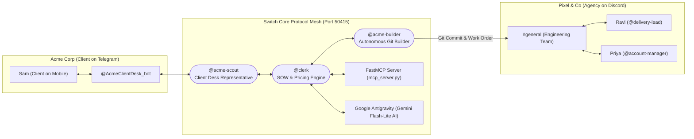
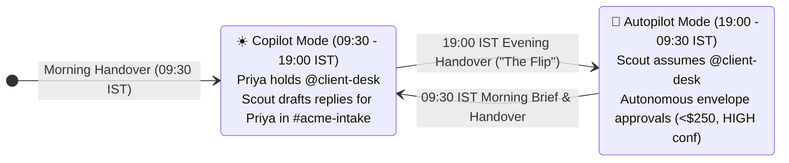

# ScopeKeeper 🛡️

> **Autonomous multi-agent client desk and scope-to-delivery governance on Switch.**  
> Built for the **[Flip the Switch Hackathon](https://www.wemakedevs.org/hackathons/switch)** (Track 1: Best Business Workflow).

[](https://github.com/scopekeeper/scopekeeper/actions/workflows/ci.yml)
[](https://github.com/sandbox-quantum/switch)
[](https://www.python.org/)
[](https://fastapi.tiangolo.com/)
[](LICENSE)

---

## 📺 Demonstration Video

[](https://youtu.be/placeholder-scopekeeper-demo)

> *3-minute walk-through showing cross-company chat on Discord and Slack, autonomous shift handovers at 19:00 and 09:30 IST, sub-minute contract classification, $140 overnight autonomous change orders, git-history grounded estimation, and zero-dollar scope swaps.*

---

## 💸 The Problem in Two Numbers

According to **Ignition's 2025 State of Client Engagement Report**:
1. **57% of software and digital agencies lose between $1,000 and $5,000 every single month** to unbilled scope creep ($12,000 – $60,000 annually per agency).
2. **78% of agency leads rarely or only sometimes charge clients for out-of-scope requests** because scope conversations happen inside informal chat channels where account managers fear client friction, lead times are slow, and delivery teams default to working nights for free.

When an agency in Mumbai (`Asia/Kolkata`) builds for a client in New York (`America/New_York`), a **14.5-hour timezone blackout** leaves client requests unanswered overnight or builds unplanned features without pricing approval.

---

## ⚡ What ScopeKeeper Does That Scope Bots Don't

Typical AI chat bots either summarize transcripts after the damage is done or naively hallucinate fixed price quotes without checking codebase git history or contractual commitments. ScopeKeeper is different:

| Capability | Generic Scope Bot | ScopeKeeper |
| :--- | :--- | :--- |
| **Triple Cross-Platform Chat** | Single bot in one chat app | Bridges **Telegram (@AcmeClientDesk_bot - Client)**, **Discord (#general - Engineering)**, and **Slack (#general - Executive & Finance)** simultaneously using Switch Core 0.31. |
| **Shift Handovers ("The Flip")** | Static 24/7 bot or human only | Autonomous **`assume_role` / `release_role`** handovers at 19:00 IST (evening autopilot) and 09:30 IST (morning copilot). |
| **Contract Boundaries** | LLM guesses scope loosely | Multi-tier classification: pre-checks (duplicate candidates & contradiction log) + Gemini AI + warranty post-rules. |
| **Pricing Engine** | Hallucinated ranges ($500 - $5,000) | **Deterministic rate-card calculation**: blended rate × hours × confidence contingency + milestone buffer. |
| **FastMCP Tool Server** | Proprietary closed plugins | Official **Model Context Protocol (MCP)** server ([`mcp_server.py`](mcp_server.py)) with 4 standard tools. |
| **Estimation Grounding** | LLM predicts arbitrary hours | Reads **41 commits and 8 `Effort-Hours:` merge trailers** from `acme-portal` git history. |
| **Zero-Dollar Scope Swaps** | "Pay us or don't get it" | Automatically identifies unstarted deliverable items with matching effort for a **$0, 0-day milestone impact swap**. |
| **Governance Envelopes** | Zero autonomy or unsafe autonomy | Autonomous approval for asks under **$250 with HIGH confidence**; human approval required for high-impact changes. |
| **Code & Preview Delivery** | Just text recommendations | **Real autonomous Git execution**: creates `feature/*` branches, writes React components, commits to Git, and dispatches work orders to Discord. |
| **Cost to Run** | $20/mo subscriptions required | **100% Free**: Powered by Google's Gemini 3.1 Flash-Lite AI with $0.00 cost and zero credit cards. |

---

## 🏛️ Architecture & Room Topology

ScopeKeeper organizes agents and team members into a single **Switch Mesh**, enforcing strict boundary isolation across organizations:



### Room Membership & Isolation Table

A core architectural principle of ScopeKeeper is that **internal rates, margin discussions, and raw implementation diffs are never exposed to the client channel**:

| Room / Platform | Bridge App | Purpose | Human Members | Agent Members | Roles Configured |
| :--- | :--- | :--- | :--- | :--- | :--- |
| **`Acme Client Desk`** | Telegram | External client support, scope asks & quotes | Sam (`client`) | `@acme-scout` | `@client-desk` (exclusive) |
| **`#general`** | Discord | Engineering team dispatch & work orders | Ravi (`delivery-lead`), Priya (`account-manager`) | `@clerk`, `@acme-builder`, `@antigravity` | `@delivery-lead`, `@builder` |
| **`#general` (My Space)** | Slack | Executive & Finance desk (Revenue realization, scope creep alerts) | CFO, Agency Founder (`executive`) | `@antigravity`, `@clerk` | `@executive-desk` |
| **`acme-intake`** | Switch Core | Internal triage & handoff between Scout and Clerk | Priya (`account-manager`) | `@acme-scout`, `@clerk` | *(Internal)* |
| **`acme-delivery`** | Switch Core | Work order approval & sprint tracking | Ravi, Priya | `@clerk`, `@acme-builder` | *(Internal)* |

> 🔒 **Strict Isolation Guarantee:** `@clerk`, `@acme-estimator`, and `@acme-builder` **never join `acme-client`**. Scout never sees pricing models, rates, or internal margin formulas.

---

## 🔄 Roles and "The Flip"

Because the agency is based in Mumbai (`Asia/Kolkata`) and the client in New York (`America/New_York`), ScopeKeeper manages shift handovers automatically using Switch Room Roles:



1. **Evening Handover (19:00 IST / 09:30 ET):**
   - Clerk emits `MODE autopilot` in `#acme-intake`.
   - Scout invokes Switch protocol `assume_role(role="client-desk")`.
   - Scout greets Sam on Discord: *"Good morning Sam! I am covering client desk until 11 PM ET while Mumbai is offline."*
   - Asks within the autonomous envelope (< $250, HIGH confidence) are priced, approved, and built overnight.
2. **Morning Brief & Handover (09:30 IST / 23:00 ET):**
   - Clerk posts the **Morning Brief** in `#acme-delivery` summarizing overnight asks, revenue billed, and pending approvals.
   - Clerk emits `MODE copilot` in `#acme-intake`.
   - Scout releases `@client-desk` (`release_role()`) back to Priya.

---

## 📖 The Life of an Ask

When Sam posts a message containing multiple requests, ScopeKeeper executes a deterministic pipeline:

```text
1. Client Message       -> "1. Login button broken on Safari, 2. Dark mode, 3. Excel export, 4. Android app"
2. Scout Relay          -> Numbered split asks relayed to #acme-intake in exact JSON/YAML format
3. Clerk Classification -> Multi-tier classifier runs pre-checks, LLM, and warranty post-rules:
                           - Ask 1: DEFECT (Contract clause 1.1) -> Free warranty fix
                           - Ask 2: IN_SCOPE (Clause 2.4)        -> Work order dispatched to Builder
                           - Ask 3: UNCLEAR (Clause 3.2)         -> Clarifying question generated (Q-0001)
                           - Ask 4: OUT_OF_SCOPE (Clause 1.3)    -> Change Room #acme-cr-004 opened
4. Estimation (CR-004)  -> Estimator scans acme-portal git history trailers:
                           - Full: 200 hours ($10,350)
                           - Smaller dashboard: 56 hours ($2,650)
5. Delivery Confirmation-> Ravi confirms 200 hours in #acme-cr-004
6. Pricing & Options    -> Clerk presents 4 standardized client options:
                           - Option A: 200h full scope ($10,350, +12 milestone days)
                           - Option B: 200h with contingency buffer
                           - Option C: 56h board-meeting dashboard ($2,650, +3 milestone days)
                           - Option D: Scope Swap (56h mobile dashboard swapped for unstarted I9, $0, +0 days)
7. Client Acceptance    -> Sam selects Option D; Clerk updates the Scope Ledger and plan in database.
```

---

## 🚀 Quickstart: Windows 1-Click Launch & Hackathon Evaluation

ScopeKeeper runs on **100% free infrastructure** on Windows (no credit cards or paid subscriptions required).

### ⚡ 1-Click Launch on Windows (Recommended for Judges)
Simply double-click:
```bash
scripts\start_scopekeeper.bat
```
This batch script automatically launches the entire coordinated multi-agent stack:
1. **PostgreSQL Server 16:** Running on port `50417`.
2. **Switch Core 0.31 Engine:** Running on port `50415` with native Telegram & Discord bridges.
3. **Mission Control Web Dashboard:** Running on [`http://localhost:5173/`](http://localhost:5173/).
4. **Autonomous Multi-Agent Orchestrator:** Active WebSocket presence and AI reasoning loop.

To stop all services when done:
```bash
scripts\stop_scopekeeper.bat
```

---

## 🔌 Model Context Protocol (FastMCP) Integration

ScopeKeeper provides a native Model Context Protocol (MCP) server in [`mcp_server.py`](mcp_server.py), implementing the open standard for tool execution supported across modern coding agents:

```bash
# Run the ScopeKeeper MCP Server
python mcp_server.py
```

### Exposed MCP Tools

| Tool Name | Parameters | Description |
| :--- | :--- | :--- |
| **`evaluate_scope`** | `request_description: str` | Evaluates requests against SOW v1.2 contract deliverables (D1: Web App, D2: Themes, D3: CSV Export). Returns `IN_SCOPE` ($0 warranty) or `OUT_OF_SCOPE` (Change Order). |
| **`calculate_pricing`** | `hours: float, rate_per_hour: float = 90.0` | Computes deterministic rate-card math with confidence contingency buffers to eliminate LLM pricing hallucinations. |
| **`get_ledger_status`** | *(None)* | Returns current approved Change Orders, consumed budget, remaining balance, and active milestone dates. |
| **`execute_work_order`** | `change_order_id: str` | Triggers the autonomous code-builder: checks out a Git branch, creates production components, commits code, and dispatches an engineering work order to Discord. |

---

## 🧪 Automated Test Verification

ScopeKeeper adheres to the strict **Superpowers Iron Law** (*Evidence before assertions always*):

```bash
# Run the complete test suite (91 automated unit & integration tests)
pytest clerk/tests -q
# Output: 91 passed in 12.21s (Exit code: 0)
```

---

## 🛠️ Alternative Developer Setup (Manual)

### 3. Run Clerk Backend & Preview Server
```bash
# Run Clerk backend (FastAPI + SSE Broadcaster on port 8080)
uv run --directory clerk python -m clerk.cli serve --port 8080

# In a separate terminal, run the local preview server (port 4300)
python scripts/preview_server.py
```

### 4. Replay the Overnight Demo Story
```bash
# Run the golden-path integration test that replays the full 14.5-hour demo story
uv run --directory clerk pytest tests/integration/test_overnight_story.py -v
```

### 5. Interactive Demo Controls
When `DEMO_MODE=true` is enabled in `.env`:
```bash
# Trigger the 19:00 IST evening handover (Scout assumes @client-desk)
just flip

# Trigger the 09:30 IST morning brief and copilot handover
just morning

# Advance simulated clock by 2 hours
uv run --directory clerk python -m clerk.cli clock +2h

# Reset database, change rooms, git branches, and clock back to seed state in <60s
just reset
```

---

## 💻 ScopeKeeper Dashboard (Frontend)

The ScopeKeeper back-office web application is located in [`dashboard/`](dashboard/). Built with Vite, React 19, TypeScript (strict), Tailwind CSS, and shadcn/ui. It features an autonomous mock mode powered by MSW and a 10-beat demo story engine, and switches to the live FastAPI backend with a single environment variable.

### Key Pages & Features
- **Mission Control (`/`):**
  - **The Desk (Hero Toggle):** Real-time day/night toggle switch sliding between Priya (day/copilot) and Scout (night/autopilot), next handover countdown, dual timezone clocks, and instant "Flip now".
  - **KPI Strip:** Live revenue protected ticker ($1,890 → $2,030), change order breakdown (sent, approved, pending, swaps), goodwill gauge (2 of 8 h), median ask-to-decision timer (52 min), and stacked category bar with accessible table fallback.
  - **Live Pipeline:** 7 kanban stages (*Received, Sorted, Waiting on client, Change path, Building, Preview, Accepted*) with layout animations (`motion`), category chips, and clause badges.
  - **Needs a Yes:** Immediate decision center for delivery lead confirmations (Ravi) and account manager approvals (Priya) with explicit `#room in Chat` confirmation dialogs before posting.
  - **Activity Feed:** Live event stream rail grouping multi-ask bursts, with actor avatars, dual timestamps (`8:30 PM IST · 10:00 AM ET`), and direct chat links.
  - **Ask Drawer:** Slide-over detail drawer showing verbatim client quote, Clerk SOW confidence meter, clause tooltips, clarification questions, work items, and goodwill actions.
- **Asks Registry (`/asks`):** Full searchable, filterable table with view presets (*All, This week, Out of scope, In-flight*) and quick-open drawers.
- **Change Requests (`/change-requests` & `/change-requests/:id`):** Codebase estimate range chart (`d3-scale`) with past history markers (61h, 52h, 18h), 4 interactive option cards (including Card D $0 deliverable swap), what-if milestone M2 ghost timeline, and approval actions.
- **Delivery Plan (`/plan`):** Weekly delivery timeline with milestone M1/M2 bars, ghost overlays, and visual scope swap indicator (`I9` swapped for `I11`).
- **Scope Contract Map (`/scope`):** Deliverables D1–D4, exclusion clauses, ask heat strips, clause excerpt dialog, and full YAML editor with schema validation.
- **Rooms Switch Map (`/rooms`):** Interactive React Flow graph (`@xyflow/react`) with live message pulse animations, membership boundary ribbon, and a Matrix Table toggle view.
- **Scope Ledger & Billing (`/ledger`):** Approved change orders summary, audit trail, CSV invoice download (`/api/invoice`), and quarterly renewal proposals.
- **Rate Governance Settings (`/settings`):** Hourly rate ($45), confidence contingency bands (5%, 15%, 25%), goodwill bucket, and live envelope simulator.
- **Public Change Order (`/co/:id`):** Clean, printable client view with print stylesheet.

### Interactive Controls & Developer Tools
- **Director Mode (`D` key or `?director`):** Floating control HUD with playback speeds (1×, 10×, 60×, 600×), step event (`.`), previous/next beat (`[` and `]`), play/pause (`Space`), and reset (`R`). In live mode, triggers backend demo endpoints (`/api/demo/*`).
- **Switch Lens:** Toggle in top bar (or `⌘K`) displaying outlined tags on all elements powered by Switch building blocks (*Room*, *Role*, *Room link*, *Reference*, *Agent*, *Membership boundary*) with architectural tooltips.
- **Command Palette (`⌘K` / `Ctrl+K`):** Global search across pages, client asks, change requests, SOW clauses, theme preferences, and quick actions.
- **Banners:** Automatic disconnected banner with reconnect button when the stream drops, and an API token configuration modal.

### Running the Dashboard
```bash
cd dashboard
npm install
npm run dev
```
Open [http://localhost:5173](http://localhost:5173).

- **Mock Mode (Default):** Runs autonomously with in-browser MSW worker and simulated story engine (`VITE_API_MODE=mock`).
- **Live Mode:** Connect to backend by setting `VITE_API_MODE=live` and `VITE_API_BASE_URL=http://localhost:8000` in `dashboard/.env`.
- **Keyboard Shortcuts:**
  - `D`: Toggle Director Mode HUD
  - `⌘K` or `Ctrl+K`: Open Command Palette
  - `Space`: Play / Pause story playback (when Director is active)
  - `.`: Step to next story event
  - `]`: Advance to next story beat
  - `[`: Return to previous story beat
  - `R`: Reset story to initial seed state
- **Run Tests:** `npm test` runs Vitest unit and component tests.
- **Production Build:** `npm run build` verifies strict TypeScript and bundles for production.


---

## 🔌 One-Click Switch Template Import

ScopeKeeper includes a verified, self-contained Switch template: [`switch/templates/scopekeeper.template.yaml`](file:///f:/2026%20-%20Projects/scopekeeper/switch/templates/scopekeeper.template.yaml).

To import into Switch Console:
1. Open **Switch Console** (`http://localhost:8000`).
2. Navigate to **Templates** → **Import Template**.
3. Select `switch/templates/scopekeeper.template.yaml`.
4. Fill in the bridge parameters (Discord bridge for `client_bridge`, Slack bridge for `agency_bridge`).
5. Click **Deploy**. Switch will instantiate all 3 core rooms, assign roles, attach scope documents, and launch agents.

---

## 🏆 Hackathon Judging Criteria Alignment

### 1. Use of Switch
- Uses Switch **Room Groups** to bundle cross-company chat spaces across Discord and Slack.
- Employs **Switch Room Roles** (`assume_role`, `release_role`, `client-desk`, `exclusive: true`) to implement human-agent shift handovers.
- Implements custom agent protocol adapter over **Switch WebSocket Streams** (`SwitchProtocolAdapter`) with independent 2-second `ping`/`pong` heartbeats, session placements, `gap` sequence re-sync, and `evicted` recovery.
- Uses **Switch Documents** (`scope-summary`, `ledger-summary`) for persistent, room-scoped reference data.

### 2. Real-World Usefulness
- Directly addresses the **$1,000 – $5,000 monthly unbilled revenue leak** experienced by 57% of software agencies.
- Solves the timezone blackout between Western clients and offshore agency delivery teams.
- Eliminates client friction through **Scope Swaps (Option D)**: giving clients flexibility while protecting agency team capacity and margins.

### 3. Working Demo
- Includes an end-to-end integration test (`test_overnight_story.py`) verifying all 7 beats of the overnight story matching Section 2 number for number.
- `reset_demo.py` cleans databases, archives open change rooms, resets git tags, and rewinds the clock in **under 20 seconds**.
- Web Dashboard API with 19 REST endpoints and a real-time Server-Sent Events (SSE) event stream (`/api/stream`).

### 4. Clarity & Replicability
- Fully deterministic: `demo-app/seed/seed_history.py` regenerates `acme-portal` with exactly 41 backdated commits, 8 `Effort-Hours:` merge trailers, and tag `seed-v1`.
- Single command execution with `justfile` targets (`setup`, `seed`, `dev`, `test`, `eval`, `reset`, `flip`, `morning`).
- Step-by-step setup guide in [`docs/switch-setup.md`](file:///f:/2026%20-%20Projects/scopekeeper/docs/switch-setup.md).

### 5. Technical Depth
- **Zero hallucinations on numbers:** Clerk verifies every number, money amount, and date against `facts` JSON before posting.
- **Strict type safety:** 100% `mypy --strict` compliance across all 71 Python source files; 0 ruff lint errors.
- **Multi-provider LLM support:** Production adapters for Google Gemini, Anthropic Claude, OpenAI, and offline Scripted LLM with automatic repair retry and SHA-256 caching.
- **Planted real-world defect:** Session expiry date parsing bug (`new Date("2026-11-04 10:00")`) replicating Safari's strict ISO parser defect with accompanying Vitest test.

---

## ⚠️ Known Limits & Boundaries

1. **Switch Tasks Deprecation:** Switch tasks were deprecated in version 0.31.0; ScopeKeeper uses GitHub Issues and local markdown tickets (`tickets/ASK-NNNN.md`).
2. **Room Documents on Bridged Chats:** Switch room documents cannot be opened from bridged Discord/Slack clients; Clerk mirrors key updates as standard chat messages.
3. **Agent-Only Room Roles:** In Switch, only agents can hold room roles (`assume_role`), while humans hold governance roles defined in `config/rooms.yaml`; Clerk reconciles both seamlessly.
4. **Offline Fallback:** If Switch Console is offline or `SCOUT_MODE=builtin`, Clerk activates an embedded, sandboxed Scout process (`BuiltinScout`) maintaining full functionality.

---

## 📄 License

ScopeKeeper is open-source software licensed under the [MIT License](LICENSE).
