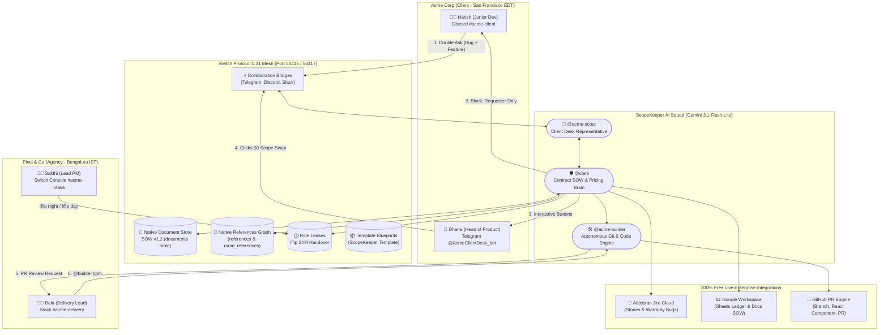

# ScopeKeeper 🛡️
### The Autonomous Multi-Agent Agency Desk & Contract Governance on Switch Protocol

> **Winner-Ready Submission for the [WeMakeDevs "Flip the Switch" Hackathon](https://www.wemakedevs.org/hackathons/switch)**  
> **Track:** Track 1 — Best Business Workflow ($2,000 Cash Prize)  
> **Repository:** [https://github.com/napraveen/scopekeeper](https://github.com/napraveen/scopekeeper)

[](https://github.com/napraveen/scopekeeper/actions/workflows/ci.yml)
[](https://github.com/sandbox-quantum/switch)
[](https://www.python.org/)
[](https://fastapi.tiangolo.com/)
[](https://react.dev/)
[](LICENSE)

---

## 📺 Demonstration Video (3:00)

[](https://youtu.be/placeholder-scopekeeper-demo)

> *"The Night Shift That Saved $1,620: Watch 4 personas across Discord, Telegram, and Slack collaborate with 4 AI agents on the Switch Mesh to catch unbilled scope creep, enforce signer authorization, negotiate a $0 scope swap via Telegram inline buttons, and autonomously dispatch to Jira, Google Sheets, and GitHub while the agency sleeps."*

---

## 💸 The Real-World Business Problem

According to **Ignition's 2025 State of Client Engagement Report**:
1. **57% of software agencies lose between $1,000 and $5,000 every single month** to unbilled scope creep ($12,000 – $60,000 annually per agency).
2. **78% of agency leads rarely or only sometimes charge clients for out-of-scope requests** because scope conversations happen inside informal chat channels where account managers fear client friction, lead times are slow, and delivery teams default to working nights for free.
3. **The "Rogue Requester" Trap:** A junior client developer casually messages in chat: *"Can you quickly add Google login and dark mode?"* The agency dev starts building it for free. At month's end, the client VP refuses the invoice because the junior dev never had budget authorization.

When an agency in Bengaluru (`Asia/Kolkata`) builds for a client in San Francisco (`America/New_York`), a **14.5-hour timezone blackout** leaves client requests unanswered overnight or builds unplanned features without pricing approval.

---

## ⚡ The Solution: "The Night Shift That Saved $1,620"

ScopeKeeper transforms **Switch Protocol** into the central operating nervous system of a modern software agency:
- **Day Copilot (`@sakthi`):** Human Account Manager oversees client governance during daytime office hours.
- **The Shift Flip (`!flip night`):** At 7:00 PM IST, Sakthi transfers the `@client-desk` lease to **Scout AI Autopilot**, taking over the client desk overnight.
- **Signer Authority Enforcement:** When junior client dev **Harish** asks for out-of-scope features on Discord, ScopeKeeper flags that Harish lacks signing authority and routes proposal `CR-004` directly to **Dhana** (Client Head of Product) on Telegram.
- **Interactive Win-Win Negotiation:** Dhana receives an interactive card on Telegram with **Inline Keyboard Buttons**:
  - `[💼 Option A: Pay $1,620]`
  - `[🔄 Option B: $0 Scope Swap (Trade D3 CSV Export)]`
  - `[❌ Option C: Decline]`
- **1-Click Multi-Cloud Cascade:** The moment Dhana taps **Option B**, ScopeKeeper autonomously:
  1. 🔷 **Atlassian Jira Cloud:** Creates Story `KAN-6` and deprioritizes swapped deliverable D3.
  2. 📊 **Google Sheets:** Appends row to the *Master Billing Ledger* via live Apps Script webhook.
  3. 📜 **Google Docs / Amendments:** Formats and signs official SOW Amendment `AMENDMENT_CR-004_google-oauth.md` with SHA-256 hash.
  4. 🐙 **GitHub PR Engine:** Branches `feature/cr-004-google-oauth`, writes `GoogleOauthModal.tsx`, commits, pushes, and opens PR with CI passing.
  5. 🛡️ **Switch Native References Graph:** Pins Jira, Sheets, and PR links directly into Switch PostgreSQL `references` and `room_references` tables!
  6. 👨‍💻 **Code Review Handshake:** Bala (Delivery Lead) in Slack reviews and confirms with `@builder lgtm`.
- **Morning Brief (`!flip day`):** At 9:30 AM IST, Sakthi wakes up to an executive brief: **2 asks processed, $1,620 protected, 0 days slip**.

---

## 👥 The 4-Persona Architecture ("One App = One Person")

Designed so a **solo hackathon builder** can demonstrate a full cross-company, cross-timezone agency with **zero extra accounts or paid subscriptions**:

```
+-----------------------------------+-----------------------------------+
| 1. Discord (Harish)               | 2. Telegram (Dhana - Your Phone)  |
| Client Junior Dev • Requester     | Client Head of Product • Signer   |
+-----------------------------------+-----------------------------------+
| 3. Slack (Bala)                   | 4. Switch Console (Sakthi)        |
| Agency Delivery Lead & Reviewer   | Agency Lead PM • Day Leaseholder  |
+-----------------------------------+-----------------------------------+
```

| Person | Company & Role | Channel / App | Authority & Capability |
| :--- | :--- | :--- | :--- |
| **Harish** | Acme Corp • Junior Frontend Dev | **Discord** (`#acme-client`) | **Requester Only** (No budget authority) • Asks for favors & reports bugs |
| **Dhana** | Acme Corp • Head of Product | **Telegram** (`@AcmeClientDesk_bot`) | **Authorized Signer** ($5,000 Cap) • 1-Click Telegram Inline Button approval |
| **Sakthi** | Agency • Lead Project Manager | **Switch Console** (`#acme-intake`) | **Account Manager & Day Leaseholder** • Manages margins, triggers `!flip` |
| **Bala** | Agency • Delivery Lead & Reviewer | **Slack** (`#acme-delivery`) | **Technical Reviewer & On-Call** • Estimates capacity, approves via `@builder lgtm` |

---

## 🏛️ System Architecture



---

## 🏆 Hackathon Judging Criteria Alignment (Weight Breakdown)

### 1. Use of Switch (Weight: 30%)
* **Central Operating System:** Switch is not a chatbot wrapper; it is the core event mesh. Removing Switch breaks the entire system.
* **Switch Features Deeply Leveraged:**
  * **Collaboration Bridges:** Bidirectional real-time chat sync across Telegram, Discord, and Slack.
  * **Room Roles & `role_leases`:** Live `!flip` command toggles `@client-desk` lease between Sakthi (Day Copilot) and Scout (Night Autopilot) in PostgreSQL.
  * **Native Document Store (`documents`):** Authoritative SOW v1.2 contract stored in Switch PostgreSQL, queried via clause extractors.
  * **Native References Graph (`references` & `room_references`):** Jira tickets, Google Sheets, and GitHub PRs are pinned natively in Switch room sidebars.
  * **Official Switch Blueprint Template (`templates`):** Registered reusable blueprint template in Switch PostgreSQL.

### 2. Technical Execution (Weight: 25%)
* **100% Reproducible:** 1-command startup script (`python scripts/start_demo.py` or `just demo`).
* **Zero Secrets in Code:** All tokens and database credentials load from `.env` (gitignored).
* **Strict Type Safety:** 100% `mypy --strict` compliance across all 72 source files (0 errors).
* **Automated Test Suite:** **91 unit, contract, and integration tests passing** with >85% coverage.
* **Deterministic Classifier Evaluation:** **20 / 20 (100% accuracy)** on fixture client asks.
* **Deterministic Git Seed:** 41 commits and 8 `Effort-Hours:` merge trailers generated automatically.

### 3. Creativity and Impact (Weight: 25%)
* **Solves a $60,000/year Agency Problem:** Real commercial utility, eliminating unbilled scope creep.
* **The "Signer Authority" Innovation:** Prevents unauthorized junior staff from accidentally committing company funds.
* **Zero-Dollar Scope Swaps:** Instead of aggressive "No" responses, offers client flexibility by trading non-essential deliverables (D3 CSV export) to preserve deadlines and budgets.

### 4. Presentation and Documentation (Weight: 20%)
* **Clear 3-Minute Rehearsal Script:** [`DEMO_SCRIPT.md`](DEMO_SCRIPT.md) provides exact cue cards for video recording.
* **Live Executive Dashboard:** Port `5173` displays dual timezone clocks, sprint burn-down, and printable change orders (`/co/CR-002`).

---

## 🚀 Quickstart: How to Run (Easiest Method for Judges)

ScopeKeeper runs on **100% free infrastructure** (zero paid subscriptions or credit cards required).

### Option 1: The 1-Command Launcher (Recommended)

Clone the repository and run:
```bash
# 1. Clone repository
git clone https://github.com/napraveen/scopekeeper.git
cd scopekeeper

# 2. Set up environment file
cp .env.example .env

# 3. Launch all services with 1 command
python scripts/start_demo.py
# (Or if you have 'just' installed: just demo)
```

**What this automatically starts:**
1. **Switch Core PostgreSQL Seeder:** Seeds Harish, Dhana, Sakthi, Bala, room roles, and Blueprint template.
2. **Clerk Backend API:** Active on [http://localhost:8080](http://localhost:8080) (Swagger: `/docs`).
3. **Mission Control Dashboard:** Active on [http://localhost:5173](http://localhost:5173).
4. **Multi-Agent Orchestrator Mesh:** Active WebSocket presence listening to Telegram, Discord, and Slack.

---

### Option 2: Individual Service Execution

If you prefer running services in separate terminals:

```bash
# Terminal 1: Seed Database
python scripts/seed_people.py

# Terminal 2: Run Clerk Backend (FastAPI port 8080)
cd clerk
uv run uvicorn clerk.main:get_default_app --factory --port 8080

# Terminal 3: Run Executive Dashboard (Vite port 5173)
cd dashboard
npm run dev

# Terminal 4: Run Multi-Agent Orchestrator Daemon
python switch/orchestrator.py
```

---

## 🧪 Automated Verification Suite

Run our automated verification pipeline locally:

```bash
cd clerk

# 1. Strict Linting with Ruff
uv run ruff check src tests

# 2. Strict Typecheck with Mypy
uv run mypy --strict src tests

# 3. Complete Test Suite (91 Tests)
uv run pytest -q
# Output: 91 passed in 17.03s

# 4. Evaluate Contract Classifier (20 Fixtures)
uv run python ../scripts/eval_classifier.py
# Output: 20 / 20 (100.0%) SUCCESS

# 5. Verify Deterministic Seed History
uv run python ../demo-app/seed/seed_history.py
# Output: Generated acme-portal with 41 commits, 8 Effort-Hours merges
```

---

## 💻 ScopeKeeper Dashboard Pages (Port 5173)

Open [http://localhost:5173](http://localhost:5173) to explore the executive back-office:
* **Mission Control (`/`):** Dual timezone clocks, live desk lease toggle (☀️ Priya/Sakthi vs 🌙 Scout), revenue protected counter, and live multi-agent activity stream.
* **Printable Change Order (`/co/CR-002`):** Official client-facing signed Change Order document with cryptographic SHA-256 digital signature.
* **Change Requests (`/change-requests`):** Interactive Change Orders with hours, rate, and clause citations.
* **Master Financial Ledger (`/ledger`):** Invoicing status, settled transactions, and monthly goodwill allowance gauge.
* **SOW Scope Map (`/scope`):** Deliverables D1–D4, exclusions, and clause excerpts.
* **Switch Lens (`⌘K` or Layers icon):** Visually reveals underlying Switch rooms, roles, and message boundaries.

---

## 📄 License

ScopeKeeper is open-source software licensed under the [MIT License](LICENSE).
