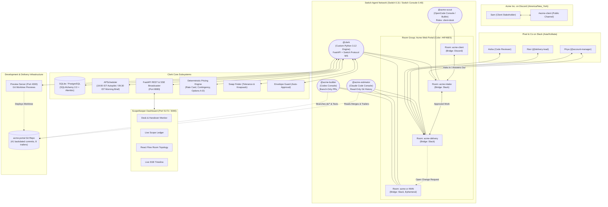
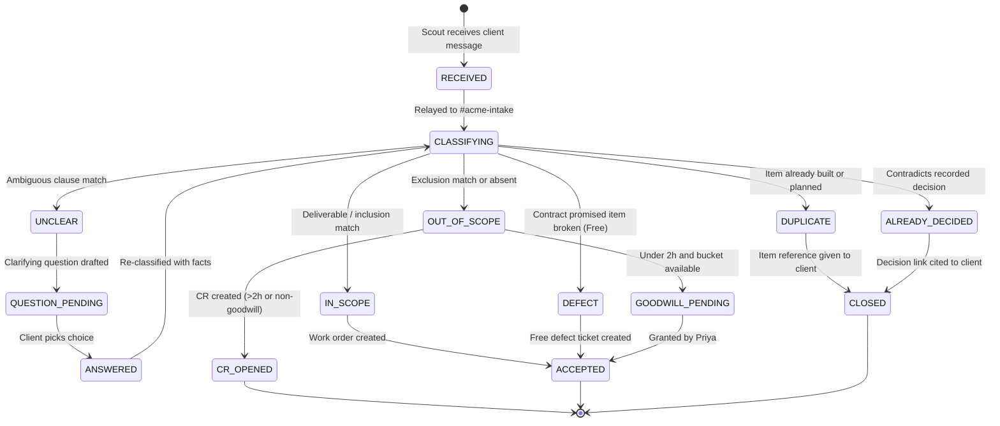
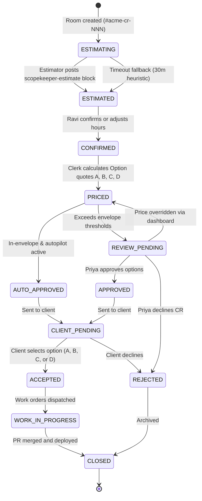
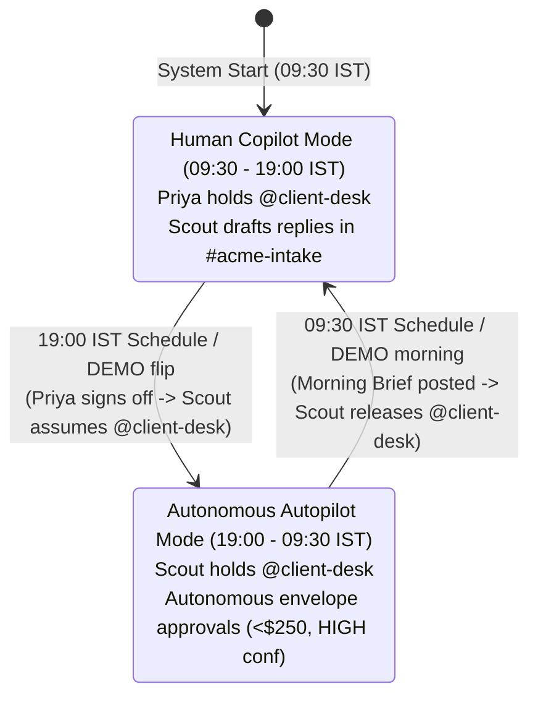

# ScopeKeeper — Architecture & State Machines

ScopeKeeper is a multi-agent, cross-company client desk and scope-to-delivery governance platform built on the **Switch Protocol** (`github.com/sandbox-quantum/switch`) for the **Flip the Switch Hackathon (Track 1: Best Business Workflow)**.

---

## 1. Component Architecture



---

## 2. Overnight Story Sequence Diagram

The overnight story replays the 14.5-hour autonomous shift from **7:00 PM IST (9:30 AM ET)** to **9:30 AM IST (11:00 PM ET)**.

```mermaid
sequenceDiagram
    autonumber
    actor Sam as Sam (Client @ Discord)
    participant Scout as Scout (@client-desk)
    participant Intake as #acme-intake (Switch)
    participant Clerk as Clerk (@clerk)
    actor Priya as Priya (Agency @ Slack)
    participant Delivery as #acme-delivery (Switch)
    participant CR_Room as #acme-cr-004 (Switch)
    participant Estimator as Estimator (@acme-estimator)
    actor Ravi as Ravi (@delivery-lead)
    participant Builder as Builder (@acme-builder)

    Note over Scout,Priya: 19:00 IST (09:30 ET): Evening Handover ("The Flip")
    Clerk->>Intake: MODE autopilot (Priya signed off)
    Scout->>Scout: assume_role("client-desk")
    Scout->>Sam: "Good morning! I am covering client desk until 11 PM ET while Mumbai is offline."

    Note over Sam,Clerk: 19:05 IST: Sam sends 4 requests in one message
    Sam->>Scout: 1. Safari login bug, 2. Dark theme, 3. Excel export, 4. Android app
    Scout->>Intake: ASK "The login button doesn't work on Safari"
    Clerk->>Intake: VERDICT ASK-0007 DEFECT clause=1.1 (Defects are free)
    Scout->>Sam: "The Safari issue is a defect under SOW 1.1; fixing it at no charge."

    Scout->>Intake: ASK "Can we get a dark theme?"
    Clerk->>Intake: VERDICT ASK-0008 IN_SCOPE clause=2.4
    Scout->>Sam: "Dark theme is in scope under SOW 2.4; building now."
    Clerk->>Delivery: WORK W-0001 branch=sk/ask-0008-dark-theme
    Builder->>Builder: implements CSS tokens & tests
    Builder->>Delivery: @clerk DONE W-0001 pr=https://github.com/acme/pull/42 preview=http://localhost:4300/sk-ask-0008/

    Scout->>Intake: ASK "Export reports to Excel please"
    Clerk->>Intake: VERDICT ASK-0009 UNCLEAR clause=3.2 QUESTION Q-0001
    Scout->>Sam: "SOW 3.2 includes CSV. Would you like Excel format (.xlsx) or is CSV sufficient?"
    Sam->>Scout: "CHOICE 1: Excel format please"
    Scout->>Intake: ANSWER Q-0001 CHOICE 1
    Clerk->>Intake: CHANGE_ORDER CR-005 price=$140 hours=3 options=A status=IN_ENVELOPE
    Scout->>Sam: "We can add Excel export for $140 (3h) with no milestone impact. Reply APPROVE to proceed."
    Sam->>Scout: "APPROVE CR-005"
    Scout->>Intake: ACCEPT CR-005

    Note over Sam,Estimator: 20:00 IST: CR-004 Opened for Android App (Out of Scope)
    Scout->>Intake: ASK "We need an Android app for the board meeting"
    Clerk->>Intake: VERDICT ASK-0010 OUT_OF_SCOPE clause=1.3
    Clerk->>Delivery: OPEN_CR CR-004 "Native Android client"
    Clerk->>CR_Room: ESTIMATE CR-004 ask="Native Android client"
    Estimator->>CR_Room: @clerk ```scopekeeper-estimate full={p50:190, p90:240} smaller={title:"View-only dashboard", p50:56, p90:64}```
    Clerk->>CR_Room: ESTIMATE_RECEIVED CR-004 waiting for @delivery-lead

    Note over Priya,Ravi: 09:30 IST (23:00 ET): Morning Brief & Copilot Handover
    Clerk->>Delivery: MORNING_BRIEF: Overnight 4 asks, $140 billed, CR-004 pending Ravi
    Clerk->>Intake: MODE copilot
    Scout->>Scout: release_role("client-desk")
    Ravi->>CR_Room: @clerk CONFIRM CR-004 hours=200
    Clerk->>CR_Room: PRICED CR-004: Option A $10,350 (+12d), B $10,350 (+12d), C $2,650 (+3d), D $0 (Swap I9)
    Priya->>CR_Room: @clerk APPROVE CR-004 options=A,C,D
    Clerk->>Intake: READY "Change Order CR-004 approved for client options A, C, D"
    Priya->>Sam: "Here are the options for the Android client: A full ($10,350), C dashboard ($2,650), D swap I9 ($0)"
    Sam->>Priya: "Let's do Option D: swap the admin analytics dashboard!"
    Priya->>Delivery: @clerk CLIENT_ACCEPTED CR-004 option=D
    Clerk->>Delivery: SWAP_RECORDED SWAP-0001: I9 swapped for W-0003; Milestone 2 date unchanged
```

---

## 3. Ask State Machine



---

## 4. Change Request State Machine



---

## 5. Shift Handover & The Flip


