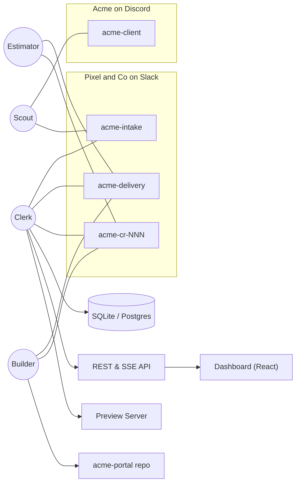

# ScopeKeeper — Implementation Plan

## 1. Architecture Overview

ScopeKeeper is a multi-agent, cross-company client desk and scope-to-delivery workflow built on **Switch** (`github.com/sandbox-quantum/switch`) for the Flip the Switch Hackathon (Track 1: Best Business Workflow).

It connects two companies across two chat apps and two timezones:
- **Acme Inc.** (Client, New York, `America/New_York`, Discord) — represented by **Sam**.
- **Pixel & Co** (Agency, Mumbai, `Asia/Kolkata`, Slack) — represented by **Priya** (`@account-manager`), **Ravi** (`@delivery-lead`), and **Aisha** (Reviewer), alongside four AI agents:
  1. **Scout** (`@acme-scout`, OpenCode via Switch Console; builtin fallback available) — Client desk agent in `acme-client` and `acme-intake`. Assumes `@client-desk` overnight (`19:00`–`09:30` IST).
  2. **Clerk** (`@clerk`, Python 3.12 + FastAPI custom service over Switch Agent Protocol) — Contract, classification, deterministic pricing, swap finder, envelope guard, change room orchestrator, ledger, and shift handover engine. Member of `acme-intake`, `acme-delivery`, and `acme-cr-NNN` (never `acme-client`).
  3. **Estimator** (`@acme-estimator`, Claude Code via Switch Console, read-only) — Sizes out-of-scope asks in `acme-cr-NNN` using the `acme-portal` codebase and git history (`Effort-Hours:` trailers).
  4. **Builder** (`@acme-builder`, Codex via Switch Console, branch-only) — Implements approved work orders on `sk/ask-NNNN-<slug>` branches and opens pull requests.



---

## 2. Repository File Tree

```text
scopekeeper/
├── README.md
├── BUILD_PROMPT.md
├── FRONTEND_PROMPT.md
├── .gitignore
├── .env.example
├── docker-compose.yml
├── justfile
├── .github/workflows/ci.yml
├── config/
│   ├── sow/SOW.md
│   ├── scope-map.yaml
│   ├── rate-card.yaml
│   ├── plan.yaml
│   ├── envelope.yaml
│   ├── schedule.yaml
│   ├── rooms.yaml
│   └── seed-ledger.yaml
├── switch/
│   ├── templates/scopekeeper.template.yaml
│   ├── rooms/
│   │   ├── acme-client.md
│   │   ├── acme-intake.md
│   │   ├── acme-delivery.md
│   │   └── acme-cr.md
│   ├── roles/
│   │   ├── client-desk.md
│   │   ├── account-manager.md
│   │   └── delivery-lead.md
│   └── agents/
│       ├── scout.md
│       ├── estimator.md
│       └── builder.md
├── clerk/
│   ├── pyproject.toml
│   ├── alembic.ini
│   ├── alembic/
│   ├── src/clerk/
│   │   ├── __init__.py
│   │   ├── main.py              # FastAPI app factory; lifespan starts workers
│   │   ├── settings.py          # .env + validated YAML config loader
│   │   ├── domain/              # Pure logic (no I/O), mypy --strict
│   │   │   ├── __init__.py
│   │   │   ├── models.py        # Domain & Frontend Data Contract Pydantic models
│   │   │   ├── categories.py    # Pre-checks, post-rules, warranty & token overlap
│   │   │   ├── pricing.py       # Decimal pricing, contingency, options A-D
│   │   │   ├── dates.py         # Milestone shifts, IST/ET timezone helpers
│   │   │   ├── swaps.py         # Unstarted item & pair swap finder
│   │   │   ├── envelope.py      # Autonomous approval envelope rules
│   │   │   ├── goodwill.py      # Monthly goodwill bucket calculator
│   │   │   ├── states.py        # Ask & ChangeRequest state machines
│   │   │   ├── parsing.py       # Chat protocol & command parsers
│   │   │   ├── templates.py     # Client & internal message/CSV templates
│   │   │   └── numbers_check.py # Guard verifying LLM text numbers against facts
│   │   ├── ports/
│   │   │   ├── __init__.py
│   │   │   └── protocols.py     # SwitchPort, LLMPort, GitHostPort, PreviewPort, ClockPort
│   │   ├── adapters/
│   │   │   ├── __init__.py
│   │   │   ├── switch_protocol.py
│   │   │   ├── switch_inmemory.py
│   │   │   ├── llm_gemini.py
│   │   │   ├── llm_anthropic.py
│   │   │   ├── llm_openai.py
│   │   │   ├── llm_scripted.py
│   │   │   ├── github.py
│   │   │   ├── local_git.py
│   │   │   ├── preview_local.py
│   │   │   └── clock.py
│   │   ├── db/
│   │   │   ├── __init__.py
│   │   │   ├── tables.py
│   │   │   ├── session.py
│   │   │   └── repositories.py
│   │   ├── services/
│   │   │   ├── __init__.py
│   │   │   ├── workflow.py
│   │   │   ├── classifier.py
│   │   │   ├── change_requests.py
│   │   │   ├── flip.py
│   │   │   ├── brief.py
│   │   │   ├── memory.py
│   │   │   ├── renewal.py
│   │   │   ├── invoice.py
│   │   │   └── scout_builtin.py
│   │   ├── api/
│   │   │   ├── __init__.py
│   │   │   ├── routes.py
│   │   │   ├── sse.py
│   │   │   └── auth.py
│   │   ├── workers/
│   │   │   ├── __init__.py
│   │   │   ├── switch_consumer.py
│   │   │   ├── scheduler.py
│   │   │   └── timeouts.py
│   │   └── cli.py
│   └── tests/
│       ├── unit/
│       ├── integration/
│       ├── contract/
│       └── fixtures/
├── dashboard/                   # Left empty for separate frontend build session
├── demo-app/
│   ├── seed/seed_history.py
│   └── acme-portal/
├── scripts/
│   ├── preview_server.py
│   ├── reset_demo.py
│   └── eval_classifier.py
└── docs/
    ├── plan.md
    ├── architecture.md
    ├── switch-setup.md
    ├── switch-protocol-notes.md
    ├── demo-script.md
    └── decisions.md
```

---

## 3. Phase Checklist & Definition of Done

- [x] **Phase 0: Verify and plan**
  - Read the Switch docs and reference implementation (`core/switch_core/bridges/agent/`).
  - Write `docs/switch-protocol-notes.md`, `docs/decisions.md`, and `docs/plan.md`.
  - Every Switch operation needed is verified with exact signatures.
- [x] **Phase 1: Scaffold and domain**
  - Repo layout, tooling (`pyproject.toml`, `.env.example`, `justfile`, `docker-compose.yml`), `config/*` files, `switch/*` instruction/template files, config Pydantic models, and all `clerk/src/clerk/domain/` modules.
  - Unit tests pass in `clerk/tests/unit` (65/65 passing, 96% domain coverage) for prices, dates, swaps, envelope, goodwill, warranty post-rules, state transitions, parsers, numbers check, templates, and config loading; `mypy --strict` and `ruff check` pass on `src/` and `tests/`.
- [x] **Phase 2: Fakes and golden path**
  - Ports (`clerk/src/clerk/ports/protocols.py`), fake adapters (`InMemorySwitch`, `ScriptedLLM`, `LocalGitHost`, `FakePreview`, `SimulatedClock`), workflow services (`ClassifierService`, `ChangeRequestService`, `BriefService`, `FlipService`, `MemoryService`, `RenewalService`, `InvoiceService`, `BuiltinScout`, `WorkflowOrchestrator`), and SQLAlchemy 2.0 database (`tables.py`, `session.py`, `repositories.py`) + Alembic migrations (`0001_initial_schema.py`).
  - The golden-path integration test (`clerk/tests/integration/test_overnight_story.py`) and companion tests pass offline (71/71 total tests passing, `ruff check` and `mypy --strict` passing across 52 source files).
- [ ] **Phase 3: Real Switch**
  - `SwitchProtocolAdapter` (WebSocket stream + 2s `ping`/`pong` heartbeat + session placements + HTTP ops), consumer worker, reconnects, and contract tests.
  - Clerk joins its rooms, maintains its heartbeat, and answers `@clerk status` in chat.
- [ ] **Phase 4: Agents, git and previews**
  - Estimator and Builder flows, `GitHostPort`, `PreviewPort`, and `docs/switch-setup.md`.
  - A real in-scope ask becomes a pull request and a preview link.
- [ ] **Phase 5: Flip, brief, memory, renewal**
  - Scheduler, handovers (`assume_role` / `release_role`), morning brief, memory queries, renewal report, and REST + SSE API matching the Frontend Data Contract.
  - The 7:00 PM and 9:30 AM handovers work on the simulated clock.
- [ ] **Phase 6: Dashboard (Skipped)**
  - Leave `dashboard/` empty for the separate frontend session; backend API & SSE stream verified against the frontend data contract with CORS enabled for `http://localhost:5173`.
- [ ] **Phase 7: Demo app and seed**
  - `demo-app/seed/seed_history.py` generating `acme-portal` with 40 commits, 8 `Effort-Hours:` merges, planted Safari date bug, `seed-v1` tag, and `scripts/reset_demo.py`.
  - `just seed` and `just reset` are repeatable in under a minute.
- [ ] **Phase 8: Docs, CI and polish**
  - `README.md`, `docs/architecture.md`, `docs/demo-script.md`, `.github/workflows/ci.yml`, and `switch/templates/scopekeeper.template.yaml` validation.
